# PRD — 自托管跨境商城（一期 MVP）

| 项 | 内容 |
|---|---|
| 文档编号 | PRD-001 |
| 版本 | v1.0（Phase 1 交付） |
| 作者 | 许清楚（产品经理） |
| 日期 | 2026-11-08 |
| 上游依据 | `C:\Users\HASEE\Desktop\全球商城项目简报.md`（项目宪章，冲突时以简报为准） |
| 下游产物 | 架构 Spec（架构师）、设计规范（设计师） |
| 状态 | 待评审 |

> **本文档与简报的关系**：简报是宪章，本 PRD 只做「把宪章翻译成可验收的产品需求」这件事，不新增范围、不改既定技术路线。
> 凡本文档与简报冲突处，一律以简报为准，并在文中标注冲突点。
> 凡本文档给出的竞品数据，均标注来源 URL 与可信度；查不到的写「未验证」，不编造。

---

## 0. 一句话说清我们在做什么

**给会一点技术、但不想被 SaaS 抽佣和数据锁定卡住的中小卖家，交付一套「一条命令装完、带完整响应式店面和管理后台、跨境与国内支付打通」的自托管商城产品。**

不是给自己开一家店，是一个可对外交付、可换肤、可二次开发的产品。

### 0.1 三个已定决策（不再讨论，此处仅记录防止后续漂移）

| 决策 | 内容 | 影响面 |
|---|---|---|
| D1 | 单商户，全周期不做多商户/Marketplace，数据模型不引入「商户」维度 | 所有模块的数据模型 |
| D2 | 只做 Web 响应式（PC + 手机 H5），不做原生 App、不做小程序 | 店面、验收口径 |
| D3 | 首发 Channel = 中国大陆 / CNY / 微信支付 | 默认种子数据、结账流程、Payment 启用清单 |

> **D3 与简报第四节的张力（提醒架构师注意，非推翻）**：简报要求一期交付微信支付、支付宝、Stripe、PayPal 四个 Provider。
> 本 PRD 的处理：**四个 Provider 的代码与配置界面都做**（这是「全球商城」的产品承诺），但**种子数据只播种中国大陆/CNY 一个 Channel，且该 Channel 默认只启用微信支付**。支付宝在同一 Channel 作为可选第三通道预留开关。
> Stripe / PayPal 一期只到「后台填密钥即可启用」的程度，不在一期做真实资金联调（理由见 §6）。

---

## 1. 产品定义

### 1.1 目标用户

不是「所有想开店的人」。是三类具体的人，共同特征是：**已经决定要自己做主，但被「自托管 = 运维地狱」这道坎挡住**。

### 1.2 核心问题

市场上只有两种选择，且两种都在某一端严重失血：

| 选择 | 拿到什么 | 失去什么 |
|---|---|---|
| **SaaS 建站**（Shopify / BigCommerce / 店匠 / Shopline / Shopware Cloud / Saleor Cloud） | 开箱即用、稳定、有人兜底 | 月费 + 抽佣 + App 税 + 数据托管在别人家 + 源码拿不到 + 换平台等于重做 |
| **自托管开源**（WooCommerce / Medusa / Saleor / BeikeShop） | 零抽佣、源码与数据自主、可任意改 | 时间。你要自己拼服务器、数据库、缓存、对象存储、邮件、备份、监控、店面、升级、安全补丁——**你不买到一家店，你买到一堆积木** |

**我们要填的空白就是这条缝**：把自托管的「所有权」和 SaaS 的「开箱即用」放进同一个交付物里。

### 1.3 一句话定位（对外可用）

> 一条命令装完的自托管跨境商城：零抽佣、数据在你自己服务器上，装完就能上架卖货。

### 1.4 差异化支柱（三条，每条都要可验收，不许停在口号）

| 支柱 | 具体承诺 | 怎么验收 |
|---|---|---|
| 一条命令 | 干净机器上执行 1 条 `curl` 脚本或 1 条 `docker compose up`，装完即用；必填配置项 = 0 | 干净 Ubuntu 22.04 机器实测，从零到能访问首页 ≤ 15 分钟，中途 0 次手填环境变量 |
| 装完就能卖 | 装完自带一套完整响应式店面 + 可用管理后台，不是「starter 骨架请自行开发」 | 装完 20 分钟内完成「上架 1 个商品 → 手机端下单 → 支付 → 后台发货」全链路 |
| 中文支付是一等公民 | 微信支付 / 支付宝不是第三方插件，是核心 Provider，环境上就绪、填密钥即用 | 后台「支付方式」页面能看到微信支付 Provider 并填写商户参数，沙箱走通 |

> 这三条正是所有竞品的差评集中区（见 §3.3），不是我们自说自话。

---

## 2. 用户画像

> 写法要求：谁 / 在什么场景 / 被什么卡住 / 现在怎么绕过 / 愿意为什么付钱。不写「中小商家」这类废话。

### P1 · 被 SaaS 抽佣磨到临界点的跨境卖家（首要目标）

- **谁**：深圳/义乌/广州，2–5 人团队，年 GMV 80 万–500 万人民币，卖 3C 配件、家居、户外。有一个兼职做图的合伙人，没有专职开发。
- **场景**：当初用 Shopify 起店，月费 $39 起，加上 6–8 个 App（评价、多语言、弃单挽回、忠诚度）每月 $150–$250，再叠加非 Shopify Payments 通道的 1%–2% 附加费。年费账单从 $500 涨到 $3,000+。
- **被什么卡住**：他很清楚「再长一年，平台拿走的就是纯利润」，但他不敢搬。搬家的成本不是钱，是**没有替代品**——WooCommerce 他试过，插件冲突把结账页搞坏过一次，大促前不敢动；Medusa 他看过文档，看到「手动配置服务器、数据库、备份、邮件、监控、无一键安装」那一串直接放弃。
- **现在怎么绕过**：继续交钱，同时私下买了个 VPS 想自建，装了三次没装成，搁置半年。
- **愿意付什么钱**：一次性买断一套「装完就能用」的系统 + 可选的部署服务。明确表示愿意为「省掉 3 周踩坑时间」付 3000–8000 元。

### P2 · 国内 DTC 品牌 / 微信生态卖家（决定一期结账流程长什么样）

- **谁**：杭州/上海的原创服饰、宠物、美妆品牌，主战场在小红书/抖音/微信私域，线下或平台店已验证产品。
- **场景**：想做一个「自己域名、自己数据」的品牌站，但客户 95% 是中国人，习惯微信支付、习惯手机下单、习惯含税价、习惯「能不能开发票」。
- **被什么卡住**：SaaS 跨境建站工具（店匠/Shopline/Shopify）的默认形态是「卖给外国人」——默认美元、默认 Stripe、默认英文模板，接微信支付要走第三方通道，移动端结账页是为欧美用户设计的。她要反过来：**中国客户为主，海外为辅，但不要两套系统**。
- **现在怎么绕过**：用有赞/微店做私域成交，但那本质还是平台，抽佣 + 数据不通 + 无法自定义域名体验。
- **愿意付什么钱**：买断 + 每年维护续费。她最在意的不是省钱，是「手机上打开快、结账不超过 4 步、微信支付不能出岔子」。

### P3 · 建站服务商 / 代运营 / 独立开发者（决定「可交付性」是否达标）

- **谁**：5–20 人的建站工作室，一年给客户交付 20–80 个商城站，技术栈偏 Node/React。
- **场景**：客户要一个独立站，预算 2–8 万。工作室现在的选择是：推 Shopify（拿不到源码、客户被锁、第二年客户可能自己续费不再找他们）或者推 WooCommerce（能拿源码，但每次 PHP 升级/插件冲突都要返工，交付后是被无限追责的售后黑洞）。
- **被什么卡住**：**没有一个「能整体交付给客户、且交付后不用天天救火」的产品**。他要的是：一套代码能复制给 N 个客户、换肤不改代码、升级不炸数据、出了问题能定位。
- **现在怎么绕过**：自己攒 Medusa + 自研 Admin，每个项目重做一遍，毛利被自己的重复劳动吃掉。
- **愿意付什么钱**：按项目买授权（多客户授权），这是长尾复购最高的一类客户。**这一类客户直接决定「模板可更换」「设计变量后台可调」「一键升级」必须是一期就要有的地基。**

### P4 · 有 TS 能力的技术型创业者（决定「不劝退」这条线画在哪）

- **谁**：1–2 人，会 Node/TypeScript，能看懂 Docker，但不想花两周做运维和 CRUD。
- **场景**：想做一个小众品类的垂直商城，或者拿商城当底座做定制化商业项目（B2B 门户、订阅盒）。
- **被什么卡住**：Medusa 的架构他很喜欢，但「装完只是 API + 半成品 Admin + starter 店面」这件事让他要写 3–6 周才能上线；且 v2.19 升级把 Admin 换到 Vite 7 / React Router 7 是破坏性变更，他怕自己维护不住。
- **现在怎么绕过**：直接用 Shopify 先把生意跑起来，把自研计划无限推迟。
- **愿意付什么钱**：买断，愿意为「模块化但开箱可用」多付。他是社区和口碑的放大器，也是最挑剔的差评来源。

---

## 3. 竞品分析

> 数据核实时间：2026-11-08。所有定价为公开页面/公开评测口径，币种如原文。
> **可信度标记**：`[官]` = 竞品官方页面/官方文档；`[评测]` = 第三方评测站/行业站；`[UGC]` = 用户社区原帖（Reddit / 官方论坛 / Trustpilot）；`[未验证]` = 多方口径冲突或无法溯源，需架构师/用户二次核对后使用。

### 3.1 直接竞品矩阵

| # | 竞品 | 定位 | 定价（核实值） | 部署方式 | 跨境能力 | 可交付性（能否整体交给客户） | 关键差评（真实，含来源） |
|---|---|---|---|---|---|---|---|
| C1 | **Shopify** | 全球 SaaS 标杆，易用性天花板 | Basic $39/mo（年付 $29）、Grow/Shopify $105、Advanced $399、Plus $2,300 起；第三方网关附加费 Basic 2% / Grow 1% / Advanced 0.6%；Shopify Payments 卡费率 2.4%–2.9% + $0.30 `[评测]` | 纯 SaaS，不提供自托管 | 强（Shopify Markets、多币种展示） | **低**：源码不可得，客户资产在 Shopify 名下；迁移成本高（vendor lock-in） | ① 2025 年春季**取消电话支持**，只能先过 AI 机器人，付费数百美元/月的商家也被描述为「unbelievably bad」`[UGC: Trustpilot 3488 条]`；② **App 税**：平均商户装 6+ 个 App，月均 App 支出约 $120，部分商户 App 花费超过主订阅；官方论坛原帖标题为「Apps Have Become Worse Than the Mafia」`[UGC: community.shopify.com]`；③ **取消/退款订单不再退还交易手续费**，退货多的商家成本激增 `[评测: Capterra]`；④ 商品变体硬上限 3 个选项 / 100 个变体；⑤ Trustpilot 1.3–1.5/5 与 G2 4.4/5 严重分裂，说明「上手好评、深度使用差评」 |
| C2 | **BigCommerce** | 无平台交易费的中端 SaaS | Standard $39 / Plus $105 / Pro $399（月付）；**按年销售额分档强制升级**：$50K / $180K / $400K，Pro 以上每 +$200K 加 $150 `[评测]`；另有 $29/$79/$299 旧口径 `[未验证]` 两口径并存 | 纯 SaaS | 中强（原生多渠道、多币种） | **低**：同 SaaS，无源码 | ① **年销售额天花板强制升级**——生意长起来就被动涨价，这是结构性的，不是可谈判的；② App 生态远小于 Shopify（约 1,000+ vs 21,000+）；③ 学习曲线比 Shopify 陡；④ 无自托管、无数据主权 `[评测: ecommerce-platforms / shopware 对比页]` |
| C3 | **WooCommerce** | 全球占有率最高的开源自托管方案 | 核心 $0；托管 $5–$350/mo（自托管成本转嫁）；扩展 $29–$299/**年·个**，且按年计费 `[官]` | 自托管（WordPress 插件） | 中：靠插件拼，多语言/多币种/税务各要装插件 | **中高**：源码可交付，但交付后是售后黑洞 | ① **插件冲突是第一大抱怨**，Reddit r/Wordpress 原话「There are constant plug-in conflicts and the site…」`[UGC]`；② 生态 CVE 持续爆发且**打补丁是你的责任**：Wholesale Lead Capture 插件被在野利用、CVE-2025-15484 认证绕过、CVE-2025-1661 未授权 LFI、Store API 漏洞 `[评测: SentinelOne/Wordfence 汇总]`；③ 每次更新是「一次掷骰子」——修 bug 还是炸结账不确定 `[UGC: boldmatch]`；④ Trustpilot 2.0/5、近 60% 负评；⑤ 性能随插件数量线性劣化，8 秒首页不罕见；⑥ 迁移潮真实存在，被业界称为「WooCommerce Refugee Crisis of 2025」 |
| C4 | **Medusa** | MIT 开源、TS 全栈、模块化单体（**我们的骨架抄它**） | 核心 MIT $0；Cloud Develop $29 / Launch $99 / Scale $299 起，Enterprise 定制 `[官]` | 自托管 或 Medusa Cloud | 强：多 Region / 多币种 / 多 Channel 是核心能力不是付费门槛 | **中**：源码可交付，但「交付物」是半成品 | **最关键的一条差评来自它自己的官方文档**：`[官]` 对比页明确列出自托管需要——手动配置服务器/数据库、手动搭部署环境、手动设扩缩容策略、手动配冗余与故障转移、手动做优化与监控、店面单独部署、自建邮件基础设施、手动备份恢复、只能依赖社区支持。第三方评测的原话是：**"You're assembling a stack, not installing a store."** 其余：② 无 admin 主题编辑器、**无拖拽建店编辑器、无一键安装**；③ starter 店面是骨架不是成品，前端要重做；④ 升级时迁移需谨慎，v2.19 把 Admin 换到 Vite 7 + React Router 7 属破坏性变更；⑤ **ARM64 Linux 上 `medusa db:migrate` 挂起**（issue #16011），跨 2.16.0/2.17.2 复现，被 stale bot 关掉未修；⑥ 默认 in-memory 的 event bus / workflow engine / locking，**容器重启丢在途流程**（如购物车完成），生产必须换 Redis 版；⑦ PayPal 集成被评测点名是弱项；⑧ 对非技术用户「完全不适用（Not for non-technical users. Full stop.）」`[评测: unsubbed.co / mrkeyoor / mith.tech]` |
| C5 | **Saleor** | BSD-3 开源、GraphQL-only、企业级 Channel 模型（**我们偷它的建模**） | 开源 $0；Cloud Select $1,599/mo（含 $200K GMV/月，超出 0.8%）、Volume $3,999/mo（含 $1M GMV/月，超出 0.4%）、Enterprise 最低 0.2%；Accelerator $6,000 一次性、FDE $12,000 一次性 `[官]` | 自托管 或 Saleor Cloud | 强：Channel / 多币种 / 翻译 / 多仓分配策略 | **中低**：可交付，但需 Python + GraphQL 能力，且无开箱店面 | ① **官网自己承认不适合大部分人**：`[官]` "let's be honest — not for everyone"，明确写「如果你要开箱即用的黑盒，请另寻他处」「如果你讨厌和工程师一起工作，我们不是你要的团队」；② Cloud 起步 $1,599/月 + GMV 抽成，**中小卖家根本进不来**；③ GraphQL-only 强制，招聘与生态受限；④ 无开箱店面（storefront 是独立仓库的示例）；⑤ 部署与运维门槛高于 Medusa |
| C6 | **Shopware** | 德国开源，欧洲企业中台 | Community Edition $0，但 **2025-03-24 起 Fair Usage Policy：年 GMV > €1M 必须转付费版**；Rise €600/mo 起、Evolve €2,400/mo 起、Beyond €6,500/mo 起 `[官/评测]` | 自托管 或 Shopware Cloud | 强：多语言/多币种/国家税率 | **中低**：可交付，但客户需 PHP/Symfony 能力；开发 €10K–€25K 起 | ① **社区版「免费」有 GMV 天花板**，做得越成功越被迫付费——这是最伤中小卖家的一条；② 需 Redis + Elasticsearch/OpenSearch，否则 ~5,000 SKU 后明显变慢，托管 €50–€150/mo 起；③ 典型店需 5–10 个付费插件，约 €1,500 首年 + €100/mo；④ 维护合同约首年开发费的 10–15%/年；⑤ 学习曲线陡、UI 密度高，非技术运营者难上手 `[评测: qualimero / shopware]` |
| C7 | **店匠 Shoplazza** | 中国卖家专用 SaaS | 基础 $28/mo（年付 $22.40）抽佣 2%；旗舰 $99（年付 $79.20）0.6%；PRO $218（年付 $174.40）0.2% `[官]` | 纯 SaaS | 中强：100+ 语言、180+ 支付、50+ 物流，中文后台 | **低**：SaaS，无源码 | ① **抽佣随档位递减但永不归零**，月流水 $100K 时高档位每月仍被抽约 $200；② **模板同质化严重、SEO 弱**，部分站点被谷歌识别为「模板站」，自然流量受限 `[评测: 大数跨境]`；③ 用户留存靠迁移成本，不靠不可替代性 `[评测]` |
| C8 | **Shopline** | 亚洲区 SaaS，营销插件强 | 入门 ¥2,064/年 抽佣 2%；基础 ¥5,688/年 0.8%；旗舰 ¥19,200/年 0.4% `[评测: 行业盘点]` | 纯 SaaS | 中：模板现代、社媒闭环强，**SEO 灵活度不够** | **低** | ① 同档位**抽佣高于店匠**（0.8% vs 0.6%、0.4% vs 0.2%）；② SEO 灵活度不足；③ 客服仅工作时间在线 `[评测]` |
| C9 | **BeikeShop** | 国产开源跨境商城（**只参考功能，禁抄代码**） | 免费开源版 $0（OSL-3.0 + 厂商附加条款：不得贩卖/再分发衍生品、不得去版权、不得再品牌化）；商业授权版价格未公开 `[官/评测]` | 自托管（Laravel/PHP） | 强：多语言/多货币/汇率更新/可视化装修 | **中低**：源码可交付，但 **OSL-3.0 对外提供服务即视为分发、衍生作品须开源**，对「做成产品卖给客户」是致命的法律约束 | ① **插件质量参差不齐**，部分有 bug 与安全问题；② 高并发下性能瓶颈明显；③ **语言包不完整**，前后台混排、页面出现 `key not found` 原始键名；④ **支付回调验签兼容性问题导致订单状态不自动更新**（这是会直接丢钱的缺陷）；⑤ 安装向导在 PHP 扩展缺失时报错不清、直接卡住；⑥ 默认伪静态规则导致商品详情页/分类页 404；⑦ 后台分类树组件在特定浏览器/PHP 版本下白屏 JS 报错 `[评测: tsight / hqwc / geekchamp]` |

### 3.2 替代方案（非产品竞争，是「用户决定用哪种范式」的竞争）

| # | 替代范式 | 典型 | 拿到什么 | 代价 | 谁还在用 |
|---|---|---|---|---|---|
| A1 | **SaaS 建站：月费 + 抽佣 + 数据托管** | Shopify / BigCommerce / 店匠 / Shopline / Shopware Cloud / Saleor Cloud | 零运维、开箱可用、生态、支付合规兜底 | 月费 + 抽佣 + App 税；无源码；数据在别人服务器；换平台等于重做；**成功反而更贵**（BigCommerce 销售额分档、Shopware €1M GMV 门禁、Saleor GMV 抽成） | 无技术团队、要快速验证、容不得宕机的小卖家 |
| A2 | **自建开源自托管：自托管 + 零抽佣 + 数据自主** | WooCommerce / Medusa / Saleor / Shopware CE / BeikeShop | 零抽佣、源码与数据完全自主、可任意改、成本只跟基础设施走 | 时间与责任：装环境、配数据库/缓存/对象存储/邮件、备份、监控、升级、打安全补丁、店面要自建；**技术债是你自己的** | 有开发能力、被 SaaS 抽佣磨到临界、或需要深度定制的团队 |

> **A1 与 A2 不是「谁更好」，而是「你把哪一类痛苦换个地方承受」。**
> 我们的产品赌的是第三象限：**A2 的所有权 + A1 的开箱体验**。

### 3.3 差评归因聚类——竞品到底在哪几个点上系统性失血

把 §3.1 里 9 个竞品的差评按「用户真正骂的是什么」聚类，得到 6 个缺口。**这 6 条就是我们的立项理由，逐条对应到一期模块。**

| 缺口 | 用户原话/证据 | 出现在哪些竞品 | 对应我们的一期模块 | 缺口的本质 |
|---|---|---|---|---|
| **G1 · 装不起来** | 「手动配置服务器、数据库、部署环境、扩缩容、冗余、监控、邮件、备份」全部手动 `[Medusa 官方]`；「有一次装失败就用旧版修复包，因为安装向导直接卡住」`[BeikeShop]`；「装了三次没装成」`[P1 访谈式推断，未验证]` | C4、C9、C3 | **Installer 一键安装**（M16） | 自托管的门槛不在代码，在**第一天** |
| **G2 · 装完还是半成品** | 「You're assembling a stack, not installing a store.」`[Medusa 评测]`；「无拖拽编辑器、无 admin 主题编辑器、无一键安装」`[Medusa 评测]`；「你买到的不是店，是一堆积木」 | C4、C5、C3 | **响应式店面**（M14）+ **管理后台基础**（M15） | 开源给的是「框架」，不是「产品」 |
| **G3 · 一升级就炸** | 「每次更新是掷骰子：修 bug 还是炸结账」`[WooCommerce UGC]`；「v2.19 把 Admin 换到 Vite 7 是破坏性变更」`[Medusa]`；「ARM64 上 db:migrate 直接挂起，被 stale bot 关掉没修」`[Medusa #16011]` | C3、C4、C9 | **版本化增量迁移纪律**（非功能，贯穿全部模块）+ 二期一键升级的地基（程序/数据隔离） | 开源项目不承诺「升级不伤数据」，而这恰恰是商家的命 |
| **G4 · 支付在国内是二等公民** | 「Shopify/BigCommerce 在欧美渠道适配度高，但对支付宝、微信支持有限」`[评测]`；「部分支付插件回调验签兼容问题导致订单状态不自动更新」`[BeikeShop]` | C1、C2、C7、C8、C9 | **Payment Provider**（M06），微信支付/支付宝为核心 Provider 而非插件 | 全球化的宣称 ≠ 中国支付的可用性 |
| **G5 · 用着用着变贵** | 「App 月均 $120，6+ 个，比主订阅还贵」`[Shopify UGC]`；「年销售额超 $50K/$180K/$400K 强制升级」`[BigCommerce]`；「CE 免费但年 GMV 超 €1M 必须转付费」`[Shopware]`；「Select 计划 $1,599/月起 + GMV 0.8%」`[Saleor]` | C1、C2、C6、C5、C7、C8 | **自托管 + 零抽佣 + 核心功能不被插件化** | 所有 SaaS 的定价模型都惩罚成功 |
| **G6 · 交付不出去** | 「SaaS 无源码、客户资产在平台名下、迁移成本高」`[多来源]`；「OSL-3.0 对外提供服务即视为分发、衍生作品须开源」`[BeikeShop 授权]` | C1、C2、C7、C8、C9 | 换肤地基（M17）+ 设计变量后台可调 + 无头架构 | 服务商（P3）需要一套**能合法整体交付给客户**的东西 |

---

## 4. 市场空白结论（≤ 200 字）

> **市面上没有「开箱即用的自托管商城」这个品类。**
> SaaS（Shopify / BigCommerce / 店匠 / Shopline / Shopware Cloud / Saleor Cloud）解决了「装不起来」，代价是月费、抽佣、App 税、数据托管、源码拿不到，且定价模型普遍惩罚成功（销售额分档、€1M GMV 门禁、GMV 抽成）。开源自托管（WooCommerce / Medusa / Saleor / BeikeShop）解决了「所有权」，代价是第一天就开始的运维与安全责任，且交付物普遍是半成品——「你买到的不是店，是一堆积木」。
> 两端都在各自那一端系统性失血，中间这条缝空着。
> **谁把自托管的第一步做成「一条命令」，谁就拿下这个品类。**

（约 190 字）

---

## 5. 一期模块清单与 RICE 优先级

### 5.1 评分口径（必须先声明，否则分数会被误读）

- **Reach**（1–10）：该模块缺位时，影响多少比例的目标用户的核心流程。**阻断型模块缺位 = 产品不可用，所以 Reach 普遍很高**。
- **Impact**（3 巨大 / 2 大 / 1 中 / 0.5 小 / 0.25 微小）：对「能否上线卖货」这件事的影响强度。
- **Confidence**（100% / 80% / 50%）：评分的确信度。
- **Effort**（1–10 相对权重，**不是绝对人月**）：以本表最重项（响应式店面）= 10 为基准的相对工时权重。绝对工期以架构师的工时分解为准。
- **Score = (Reach × Impact × Confidence) / Effort**

> **RICE 的两个陷阱，本文档明确规避**：
> ① RICE 会把「必须存在才能运行」的模块排在中间（因为 Effort 大），但这类模块的**真实优先级是无限大**——缺了就不是低优先级，是不存在。因此本表额外加 **「门槛」列**：标 `阻断` 的模块不参与「做不做」的讨论，只参与「做到多深」的讨论。
> ② RICE 会诱使团队先做高分小功能、后做地基，导致返工。因此排期不按 Score 排序，按 **简报第九节的周次顺序**（地基 → 主轴 → 交易 → 支付 → 店面 → 后台 → 验收）。RICE 在本项目的真实用途是：**§6 砍单决策的依据**，即「哪些模块可以把深度降下来」。

### 5.2 一期 18 个模块 RICE 全表

| # | 模块 | 门槛 | Reach | Impact | Conf | Effort | Score | 一期交付深度 |
|---|---|---|---|---|---|---|---|---|
| M11 | **Auth** 认证与授权 | 阻断 | 10 | 3 | 100% | 4 | **7.50** | 顾客端邮箱+密码注册登录（含游客下单）；管理员账号由 Installer 自动创建；会话/刷新令牌；权限模型按「管理员/店员」两档 |
| M10 | **Customer** 客户 | 阻断 | 10 | 2 | 100% | 3 | **6.67** | 客户档案、地址簿（多地址）、订单历史、账号合并（游客→注册）；不做客户分组（二期 B2B 用） |
| M13 | **File** 文件 | 阻断 | 10 | 2 | 100% | 3 | **6.67** | Provider 化存储接口 + 本地存储默认开箱可用 + S3 兼容为后台可选项；图片多尺寸派生；上传校验（类型/大小/尺寸）；数据卷独立挂载 |
| M04 | **Cart** 购物车 | 阻断 | 10 | 3 | 100% | 5 | **6.00** | 匿名/登录购物车、加购/改量/删、行小计、运费与税预留字段、购物车→订单的 Workflow（含 compensation） |
| M02 | **Pricing** 定价 | 阻断 | 10 | 2 | 100% | 4 | **5.00** | 按「币种 × Channel」定价；价格表（price list）模型；**不做自动汇率换算**；**含税价口径（Q5 已定案）**，税率与税额进订单行快照 |
| M16 | **Installer** 一键安装 | **差异化门槛** | 10 | 3 | 100% | 6 | **5.00** | 一条 curl 或一条 compose 拉起全部服务；自动生成配置与密钥、自动迁移、自动建初始管理员、自动健康检查；必填配置 = 0；按内存/CPU 自动调参；干净机器实测通过；**单实例只服务一个地区（面向国内或面向海外二选一，Q1 已定案）** |
| M12 | **Event Bus** 事件总线 | 骨架级 | 10 | 2 | 100% | 4 | **5.00** | 进程内事件 + Subscriber 解耦；Redis 持久化队列保证重启不丢在途任务；**死信/重试/对外 Webhook 延到二期** |
| M03 | **Region + Channel** 区域与市场 | 阻断（架构） | 10 | 2 | 100% | 5 | **4.00** | 完整建模 Region（地理/币种/多国家）+ Channel（挂载定价/库存/仓库/税务/支付配置）；**Channel 增加「地区属性」，支付 Provider 按地区可用性过滤（Q1 已定案）**；**只播种 1 个 Channel（中国大陆/CNY）**；URL 结构 `/{locale}/{channel}/…`；一期 locale 只有 `zh-CN`（可扩展但不出第二语言） |
| M08 | **Fulfillment** 履约 | 阻断 | 10 | 2 | 100% | 5 | **4.00** | 配送 zone 按 Channel、运费方案（固定/按重量/满额包邮）、发货单与包裹拆分、**手工填快递公司与单号**；承运商 API Provider 一期只定接口不接实现 |
| M01 | **Product** 商品 | 阻断 | 10 | 3 | 100% | 8 | **3.75** | product type 定义属性集；attributes 可复用/可筛选/可翻译；规格 variants 与属性分离建模；多图/主图/比例裁切；上下架与草稿态；slug 可翻译 |
| M05 | **Order** 订单 | 阻断 | 10 | 3 | 100% | 8 | **3.75** | 订单状态机（待付/已付/已发货/已完成/已取消/**已退款**）；订单行快照（价格/税/属性冻结）；**一期只开全额退款路径**，部分退款与退货流程见 §6 |
| M15 | **管理后台基础** | 阻断 | 10 | 3 | 100% | 8 | **3.75** | 商品/订单/客户/设置四块；干净聚焦、禁 ERP 密集表格风；设计变量调整入口；**不做仪表盘高级报表** |
| M06 | **Payment** 支付 | 阻断 | 10 | 3 | 100% | 9 | **3.33** | Provider 接口 + 四个实现（微信支付 / 支付宝 / Stripe / PayPal）；按 Channel 独立配置启用；**按 Channel 地区过滤：中国大陆 Channel 不显示 Stripe（这是产品行为，不是 bug，Q1 已定案）**；密钥后台填写；一期微信支付走沙箱或真实商户号，其余三个到「填密钥即启用」 |
| M07 | **Inventory** 库存 | 阻断 | 9 | 2 | 100% | 6 | **3.00** | 库存量与预留分离；**一期只启用 1 个默认仓库，但保留 warehouse/stock_location 维度 + reservation 独立记账（Q6 已定案，reservation 绝不可简化成「下单即扣库存」）**；分配策略一期只留「按优先级」一种 |
| M14 | **响应式店面** | 阻断（B 端卖点） | 10 | 3 | 100% | 10 | **3.00** | **13 页 = 前台 9（首页/PLP 分类+搜索复用/PDP 商品详情/购物车/结账/支付结果/订单查询/账户/404·错误）+ 后台 4（登录/商品/订单/设置）**，与 UIUX.md §9 对齐；一套代码覆盖 PC + 手机 H5；移动优先结账 **4 步（联系方式/地址/配送/支付+确认）**；LCP < 2.5s |
| M17 | **换肤地基**（设计变量） | 支撑 | 8 | 1 | 100% | 3 | **2.67** | 主色/字体/圆角/阴影/Logo/商品图比例集中为一份变量表；后台可调；调完店面外观变化而店面代码零改动；**不做拖拽装修**（二期） |
| M09 | **Tax** 税务 | 可降级 | 6 | 1 | 100% | 3 | **2.00** | **一期只做「单一扁平税率 + 含税价」的 Channel 级配置**；税额落订单行列 + 完整快照落 `order_item_snapshot`（Q5 已定案，字段归属见 §6 K3）；税区/多税率/税计算 Provider 接口只留签名不接实现 |
| M18 | **可嵌入组件** | 可延后 | 5 | 1 | 80% | 3 | **1.33** | 一期把自有组件（购物车抽屉、商品画廊、规格选择器）做成「可独立挂载的组件」，为二期多模板与 AI 客服窗口铺路；**一期只抽组件边界，不做组件市场** |

> **Effort 合计 = 97（相对权重）**。这个数字没有任何绝对时间含义，只用于比较模块之间的相对轻重。
> 一期真实工期以简报第九节的 4–8 周为准；若架构师的工时分解显示超出，砍单顺序见 §6。

### 5.3 从 RICE 直接读出的三个结论

1. **Auth / Customer / File 排前三不是因为它们重要，是因为它们轻且阻断。** 这是 RICE 的假象，别误读成「先做这三个」。
2. **响应式店面 Score 最低（3.00），但它是一期的对外卖点。** 这说明「按 RICE 排序做」对我们是错的——店面 Effort 10 是因为它要覆盖 13 页（前台 9 + 后台 4）× 移动优先 × 性能预算，不是因为它可省。
3. **Tax（2.00）和可嵌入组件（1.33）是唯二可以「降深度而不伤交易闭环」的模块。** 这在 §6 里被采纳。

---

## 6. 砍单建议（明确回答：哪几项能推到二期而仍然能上线卖货）

> **前提**：简报第四节已把 18 个模块全部划进一期，本 PRD 不擅自减少模块。以下是「**保留模块壳、把深度推到二期**」的建议——每一项都写清「降深度的具体做法」「为什么仍能卖货」「风险与被推翻的条件」。

### 6.1 建议降深度 / 推二期的 7 项

| # | 项 | 一期做法（降深度后） | 推到二期的部分 | 为什么仍能上线卖货 | 风险 | 被推翻的条件 |
|---|---|---|---|---|---|---|
| **K1** | **Inventory 多仓** | 只播种 1 个默认仓库；库存量 + 预留分离照做；分配策略只保留「优先级」一种 | 多仓建模落地、按库存量分配、跨仓调拨、仓库级可用量展示 | 单商户单市场首发，货就在一个仓/一个代发点，**多仓对首单闭环零贡献** | **数据模型风险最高的一项**：若一期把 warehouse 写死成单值或把 reservation 记账简化成「扣库存」，二期加多仓要改 Order 与 Cart 的可用量计算，属破坏性改造 | **✅ 已定案（架构师 Q6 裁决）**：支持砍单、不撤回；保留 warehouse/stock_location 维度 + reservation 独立记账 + 只启用 1 个默认仓库，成本显著低于多仓全量（约省 2 天）。**硬约束：reservation 绝不可简化成「下单即扣库存」**，否则二期加多仓是破坏性改造 |
| **K2** | **Fulfillment 承运商 Provider** | 手工填「快递公司 + 单号」；运费方案做固定/按重量/满额包邮三种；发货单与包裹拆分照做 | 承运商 API Provider（顺丰/菜鸟/4PX/云途等）、轨迹自动同步、面单打印 | 卖货只需要「发货 + 客户能看到单号」，**轨迹自动同步是体验加分不是交易阻断** | 客户会问「为什么不能自动同步物流」；代运营客户（P3）交付时会被质询 | 若目标客户以「跨境小包 + 多承运商」为主，手工填单号会被运营视为不可用 |
| **K3** | **Tax 税务** | 单一扁平税率 + 含税价；税率值冻结进订单行快照 | 税区模型、多税率、税计算 Provider（TaxJar/Avalara 类）真实接入、欧盟 VAT 自动判定 | 首发 Channel 是中国大陆/CNY，**单一税率足够跑通闭环**；且税值已进快照，二期换算法不脏数据 | **合规风险**：若客户拿去做欧盟销售，未配 VAT 自动计算可能被稽查补税+罚款（行业资料称可达货值 80% 以上）。这不是产品缺陷，是**必须写进交付文档的免责与提示** | **✅ 已定案（架构师 Q5 裁决）**：税额落订单行列，完整快照落 `order_item_snapshot`，不建独立 Order Adjustment 表（那是二期 Promotion 概念，现在建空表是镀金）。字段：`order_line_item.unit_price_minor`（含税口径由 channel 决定）/ `tax_rate`（basis points 整数，如 1300=13%）/ `tax_amount_minor`（行级）；`order.tax_amount_minor`（订单级汇总含运费税）；`order_item_snapshot`（jsonb 存下单时变体完整快照） |
| **K4** | **Order 部分退款 / 退货** | 状态机完整建模（待付/已付/已发货/已完成/已取消/已退款）；**只开「全额退款」路径**；退款走 Workflow + compensation（支付网关退款失败要能回滚状态） | 部分退款、按行退款、退货单（RMA）、换货、退款原因分类与审批流 | 「能退全款」已覆盖绝大多数纠纷场景；部分退款可由商家线下补差 | 服饰/鞋类等退货率高的品类会立刻遇到「只退一件」的需求，只能人工处理 | 若目标客群中服饰/美妆占比高（退货率天然高），K4 应回一期 |
| **K5** | **可嵌入组件（M18 深度）** | 只做「组件边界划分」：购物车抽屉、商品画廊、规格选择器写成可独立挂载的组件，不经全局状态 | 组件市场、跨模板的组件契约与版本管理 | 一期只有一套店面模板，**没有第二个宿主需要嵌入**，做深了也没有使用场景 | 若二期多模板时组件契约不兼容，要回头重构店面（但成本远小于一期为一个不存在的能力付账） | 若一期就要交付 2 套以上店面模板（简报把多模板放二期，故不成立） |
| **K6** | **Event Bus 可靠性深度** | 进程内事件 + Redis 持久化队列；保证重启不丢在途任务 | 死信队列、指数退避重试、对外 Webhook 投递层（订阅/签名/重试/死信）、事件回放 | 一期没有外部订阅方；内部流程用 Workflow 编排已保证一致性 | 若一期就要对接 ERP/CRM（P3 的客户常有此需求），没有对外 Webhook 会被视为缺功能 | 若出现「一期就要对接外部系统」的真实客户，Webhook 层提前到一期 |
| **K7** | **Auth 第三方登录** | 邮箱 + 密码；游客下单；管理员两档权限 | 微信 OAuth / 手机号短信验证码登录 / 单点登录 | 结账不强制登录（游客可下单），**注册摩擦不阻断首单** | 中国 C 端用户对「手机号一键登录」有强预期，仅邮箱注册会掉转化 | 若客户主战场是微信生态（P2），手机号登录应提前；但短信服务商会**违反「必填配置恒为 0」**（见 §12 待决 Q3） |

### 6.2 明确「不许砍」的 5 项（防止后续被 RICE 误伤）

| 项 | 为什么不许砍 |
|---|---|
| **M16 Installer 一键安装** | 它是产品品类定义，不是功能。砍了我们就变成「又一个 Medusa」。 |
| **M14 响应式店面** | B 端卖点；砍成「只有 PC」等于放弃 P2 与 P3。 |
| **M17 换肤地基** | Effort 只有 3，但它是 P3（服务商）付钱的唯一理由；延到二期会导致一期交付物无法复制给第二个客户。 |
| **交易闭环四件套（Cart→Order→Payment→Fulfillment 手工发货）** | 简报的验收定义就是它。 |
| **版本化增量迁移纪律** | 非功能但不可谈判：它是「二期一键升级不伤数据」的唯一前提，事后补是数周级返工（简报第十一节原话：「优调先做是习惯、后补是重构」）。 |

### 6.3 砍单后的净效果

- 一期交付**模块数仍是 18 个**，但 **Effort 从 97 降到约 82**（相对权重，主要是 K1/K2/K3/K4 省下的深度）。
- 一期验收口径不变：**干净机器一条命令装完 → 上架 → 手机下单 → 微信支付 → 后台发货**，双端跑通。
- 二期回补顺序建议：K1 多仓 → K2 承运商 → K4 部分退款 → K3 税区 → K6 Webhook → K5 组件契约 → K7 第三方登录。

---

## 7. 不做清单（Out-of-Scope）

> 每条必须写「原因」与「何时考虑」。没有「何时考虑」的不做项等于埋雷。

| # | 不做 | 原因 | 何时考虑 |
|---|---|---|---|
| O1 | 多商户 / Marketplace | 简报定案：全周期单商户，数据模型不引入商户维度 | 永不做（宪章级） |
| O2 | 原生 App（iOS/Android） | 简报定案：已从整个产品范围移除 | 永不做（宪章级） |
| O3 | 微信小程序 | 同上，只做 Web 响应式 | 永不做（宪章级） |
| O4 | GraphQL API | 简报定案：对外只提供 REST（Store API + Admin API 分离） | 永不（除非出现无法用 REST 满足的官方店面需求） |
| O5 | MySQL 支持 | 简报定案：PostgreSQL only | 永不 |
| O6 | 自动汇率换算 | 简报定案：Pricing 只做按币种定价，不换算 | 二期多市场扩张时，作为「汇率参考展示」而非自动结算 |
| O7 | 自动税计算（真实 Provider 接入） | K3 砍单项 | 二期；或首个欧盟/英国客户出现时立即 |
| O8 | 促销三件套（目录促销/订单促销/Voucher）与礼品卡 | 简报明列二期 | 二期第 1–2 周 |
| O9 | 优惠券、满减、限时秒杀、限购 | 属促销体系 | 二期 |
| O10 | 站内专用搜索引擎（Meilisearch/Algolia） | 简报明列二期；一期用 PostgreSQL 全文检索兜底 | 二期；或商品数 > 5,000 且搜索转化被投诉时 |
| O11 | 全量多语言翻译与多 locale 上线 | 一期只播种 `zh-CN`；模型可扩展但不投入内容 | 二期 Translation 模块 |
| O12 | 拖拽装修编辑器 / CMS / 博客 | 简报明列二期 | 二期第 4–6 周 |
| O13 | 多店面模板 + 按 Channel 分配不同店面 | 简报明列二期 | 二期 |
| O14 | AI Gateway / AI 客服 | 简报明列二期 | 二期第 7–10 周 |
| O15 | 后台一键升级（System Update） | 简报明列二期；但一期必须交付「增量迁移 + 程序/数据隔离」的地基 | 二期；**地基不能延后** |
| O16 | 对外 Webhook 投递层 | K6 砍单项 | 二期；或首个 ERP/CRM 对接需求出现时 |
| O17 | B2B（客户组 / 价格表 / 草稿单 / 报价 / 审批） | 简报明列二期与三期 | 二期基础版，三期完整套件 |
| O18 | Loyalty / Store Credit / 订阅 / 数字商品 | 简报明列三期 | 三期 |
| O19 | 商品评价与评分体系 | 影响转化但不阻断交易；评价体系涉及审核、反刷、图片存储，成本高于收益 | 二期；若客户主营 DTC 且明确要求社会证明 |
| O20 | 发票系统（中国大陆增值税发票开具） | 涉及税控设备/第三方开票平台对接，**与「必填配置为 0」直接冲突** | 见 §12 Q4；若首发即为国内 B 端客户，则提为二期 P0 |
| O21 | 物流轨迹自动同步 | K2 砍单项 | 二期 |
| O22 | 邮件营销 / EDM / 弃单挽回 | 简报明列 Notification 在二期；弃单挽回依赖 Notification 与促销 | 二期 |
| O23 | 联盟分销 / 佣金体系 | 无简报依据，属范围蔓延 | 不在三期蓝图内，若商业需要另立项 |
| O24 | 支付风控 / 反欺诈 / 3DS 强认证编排 | 一期由支付 Provider 自带能力承担；自建风控需要数据积累 | 三期；或拒付率接近 1% 阈值时（行业资料称连续两月 >1% Stripe 会暂停账户） |
| O25 | 多币种**同时**展示与自动切换 | 一期一 Channel 一币种；多币种展示会引入汇率与四舍五入一致性问题 | 二期多 Channel 时 |
| O26 | 礼品卡 / 储值 | 涉及预付资金合规（国内尤其敏感） | 三期 Store Credit |
| O27 | 高并发压测与弹性扩缩容 | 简报定位单人全职 + Docker Compose 部署，不做 K8s/自动扩缩 | 若出现单日 > 5 万订单场景 |
| O28 | 可视化报表 / BI / 数据大屏 | 一期后台只做操作，不做分析 | 二期；依据埋点数据反推需求优先级 |

**不做清单共 28 条。最关键 3 条：O1（多商户）、O11+O12+O13（多语言/装修/多模板——这是「看起来像竞品」的诱惑来源）、O20（发票——最容易在一期被塞进来的伪需求）。**

---

## 8. 核心用户流程

### 8.1 端到端主流程（上架 → 下单 → 付款 → 发货）

```mermaid
flowchart TD
    subgraph A["阶段 A · 安装（一次性，≤15 分钟）"]
        A1["干净服务器执行<br/>1 条 curl 脚本 / 1 条 docker compose up"] --> A2["自动拉起<br/>App + Worker + PostgreSQL + Redis"]
        A2 --> A3["自动生成配置与密钥<br/>自动执行迁移"]
        A3 --> A4["自动创建初始管理员账号"]
        A4 --> A5["自动健康检查通过"]
        A5 --> A6["输出后台地址 + 管理员账号<br/>必填配置 = 0"]
    end

    subgraph B["阶段 B · 上架（商家，≤10 分钟）"]
        A6 --> B1["后台登录"]
        B1 --> B2["创建 product type<br/>定义属性集"]
        B2 --> B3["创建商品<br/>填属性 + 生成 variants"]
        B3 --> B4["上传图片<br/>按固定比例裁切"]
        B4 --> B5["设置 Pricing<br/>币种 CNY × Channel"]
        B5 --> B6["设置库存量<br/>默认仓库"]
        B6 --> B7["上架"]
    end

    subgraph C["阶段 C · 消费者下单（手机 H5 优先）"]
        B7 --> C1["/{locale}/{channel}/ 首页<br/>分类 / 搜索"]
        C1 --> C2["商品详情页<br/>规格选择联动价格与库存"]
        C2 --> C3["加入购物车<br/>乐观更新 + 失败回滚"]
        C3 --> C4["购物车<br/>金额汇总"]
        C4 --> C5["结账第 1 步：联系方式<br/>游客填手机号/邮箱 · 登录则预填"]
        C5 --> C6["结账第 2 步：收货地址<br/>地址簿或新地址"]
        C6 --> C7["结账第 3 步：配送方式<br/>运费方案计算"]
        C7 --> C8["结账第 4 步：支付方式<br/>按 Channel + 地区过滤"]
        C8 --> C11["提交订单"]
    end

    subgraph D["阶段 D · 支付（Workflow 编排 + compensation）"]
        C11 --> D1["创建订单<br/>状态 = 待付"]
        D1 --> D2["预留库存<br/>reservation 记账"]
        D2 --> D3["发起支付<br/>Provider: 微信支付"]
        D3 --> D4{"支付回调验签"}
        D4 -->|失败/超时| D5["订单保持待付<br/>释放预留（补偿）"]
        D5 --> D6["展示重试入口<br/>不丢购物车内容"]
        D4 -->|成功| D7["订单状态 = 已付<br/>预留转为实扣"]
        D7 --> D8["触发订单已付事件<br/>进程内 Event Bus"]
        D8 --> D9["结账结果页<br/>订单号 + 预计发货时间"]
    end

    subgraph E["阶段 E · 发货"]
        D9 --> E1["后台订单列表<br/>筛选「已付待发货」"]
        E1 --> E2["生成发货单 / 拆包裹"]
        E2 --> E3["填快递公司 + 单号"]
        E3 --> E4["订单状态 = 已发货"]
        E4 --> E5["触发已发货事件<br/>（一期无 Notification，仅状态可见）"]
        E5 --> E6["消费者在个人中心<br/>看到物流单号"]
        E6 --> E7["商家标记完成 / 或发起全额退款"]
        E7 --> E8["订单状态 = 已完成 / 已退款"]
    end

    style A fill:#E8F1FB,stroke:#3B6FA8
    style D fill:#FDF0E6,stroke:#B5713A
    style C fill:#EDF6EE,stroke:#3F7A4A
```

### 8.2 三条关键异常流程（必须实现，不是可选项）

| 流程 | 触发条件 | 系统行为 | 验收标准 |
|---|---|---|---|
| **F1 支付失败/超时** | 支付网关返回失败、回调验签失败、用户主动关闭支付 | 订单保持「待付」；**释放库存预留**（compensation）；不清空购物车；结果页给重试按钮与超时提示。**释放机制（Q7 已定案）**：30 分钟超时由 `scheduler` 的 repeatable job 触发 workflow「expire-cart-payment」，三步各有 compensation——`order.transition(canceled)` + `inventory.releaseReservation` + `payment.cancelSession` | Given 支付回调验签失败, When 用户返回, Then 订单状态仍为待付、库存预留已释放、购物车内容完整、可重试 |
| **F2 库存不足（并发抢购）** | 下单时预留失败（库存已被占） | 在提交订单阶段拦截，**不创建订单**；明确提示「商品 X 库存不足，剩余 N 件」；不进入支付 | Given 库存 1 件且已被另一笔订单预留, When 用户提交订单, Then 不生成订单、提示具体商品与剩余量、购物车保留 |
| **F3 全额退款** | 商家在后台对已付/已发货订单发起退款 | 走 Workflow：调支付网关退款 → 成功后订单状态改「已退款」并回补库存（可配置）→ 失败则回滚状态并提示 | Given 商家对已付订单发起全额退款, When 网关退款成功, Then 订单状态=已退款、退款金额=实付金额、库存按配置回补；When 网关退款失败, Then 订单状态回滚为已付并给出失败原因 |

---

## 9. 一期成功指标（可量化，不达标不上线）

### 9.1 交付门槛指标（MVP 验收线，全部必须满足）

| # | 指标 | 目标值 | 测法 |
|---|---|---|---|
| S1 | 干净机器安装成功 | 1 条命令，**一次成功率 100%**（连续 3 次全新机器） | 目标机：Ubuntu 22.04，4C8G，空白磁盘，无 Docker、无 Node、无 PostgreSQL |
| S2 | 安装耗时 | 从执行命令到首页可访问 **≤ 15 分钟**（含拉镜像） | 同上机器，秒表记录 |
| S3 | 必填配置项数 | **= 0** | 安装过程全程录屏，统计需要人工输入的配置项 |
| S4 | 首单闭环耗时 | 装完后 **≤ 20 分钟**完成「上架 1 个商品 → 手机下单 → 支付 → 后台发货」 | 由未参与开发的人操作，不使用文档 |
| S5 | 支付沙箱通过 | 微信支付沙箱（或测试商户号）**下单→回调→订单变已付**成功率 100%（10 次连续） | 自动化脚本 + 人工复核 |
| S6 | 迁移纪律 | 全部迁移为增量（加表/加列）；**零手工改表**；迁移可在全新 DB 上从零跑到最新版本 | Code Review + CI 检查（review 出现破坏性迁移直接打回） |
| S7 | 数据隔离 | 程序目录可整体替换，数据卷与配置密钥不动；替换后数据零丢失 | 演练：备份 → 替换程序目录 → 重启 → 校验订单/商品/客户数量与内容 |
| S8 | 性能预算（一期即为底线） | 首页 / 商品页 / 结账页 **LCP < 2.5s** | 真实 4G 手机网络（非模拟器），移动端优先 |
| S9 | 布局稳定性 | 三页 **CLS < 0.1**；图片与异步区块预留固定尺寸 | Lighthouse / WebPageTest |
| S10 | 移动端结账步数 | 从加购到支付成功 **4 个表单步骤**（联系方式 / 收货地址 / 配送方式 / 支付方式+确认），**单步字段 ≤4** | 人工走查计数；步数从 3 改为 4 的定案理由见 §13.3 X7（跨境单页 12+ 字段超工作记忆，分步每步 ≤4 字段） |

### 9.2 产品假设验证指标（上线后 30 天，决定是否值得继续投入）

| # | 假设 | 指标 | 判定 |
|---|---|---|---|
| H1 | 「一条命令装完」是这个品类的真需求 | 安装完成率（启动安装 → 健康检查通过）**≥ 70%** | <40% 说明门槛不在安装，产品定位需重审 |
| H2 | 装完能开卖 | **首次上架到首单完成 ≤ 24 小时**的用户占比 ≥ 50% | <30% 说明店面或后台有阻断性摩擦 |
| H3 | 移动端是主战场 | 移动端下单占比 **≥ 70%** | <50% 说明响应式投入产出比需重新评估 |
| H4 | 支付不是瓶颈 | 结账页 → 支付成功转化 **≥ 60%** | <40% 优先排查支付 Provider 与结账步数 |
| H5 | 数据自主是付费理由 | 购买/试用用户中，把「数据在自有服务器 / 无抽佣」列为首要原因的比例 **≥ 40%** | <20% 说明差异化讲错了 |

> H1–H5 的埋点方案见 §11，**不埋点 = 上线后无法验证产品假设**。

### 9.3 明确不在一期考核范围内

并发能力、多仓、促销效果、AI 客服满意度、国际化覆盖率、后台升级成功率（二期才有）——一期不为这些背指标。

---

## 10. 边界条件与非功能需求

### 10.1 边界条件清单（每条都要有确定行为，不许「待定」）

| 类别 | 场景 | 期望行为 |
|---|---|---|
| 空状态 | 商品数为 0 时的首页/分类页 | 展示「还没有商品的占位说明 + 后台入口提示」，不显示空白页或报错；不出现模板占位文案 |
| 空状态 | 购物车为空 | 展示空购物车说明 + 「去逛逛」入口，不显示金额汇总 0 元 |
| 空状态 | 订单列表为空 | 展示说明 + 「去逛逛」，不显示表头空表 |
| 空状态 | 后台未配置任何支付方式 | 结账页明确提示「该市场暂未开放支付方式」，禁止进入支付并挂住 |
| 错误状态 | 支付网关超时 | 见 §8.2 F1：订单待付 + 释放预留 + 可重试 |
| 错误状态 | 图片上传失败/超限 | 明确提示失败原因（类型/大小/尺寸），已填表单内容不丢 |
| 错误状态 | API 5xx | 前台展示可重试的错误态（不白屏），后台展示错误详情与请求 ID 便于定位 |
| 异步 | 支付回调超时后用户已离开结果页，稍后返回 | **结果页可重入 + 订单查询页兜底**：按订单号重查支付状态并幂等更新，不做「一次性结果态」；未支付则给「去支付」，已支付则给「已支付」，不给中间悬空态 |
| 加载状态 | 首页/列表/详情 | 骨架屏（不用整页加载动画）；**不出现整页白屏** |
| 加载状态 | 加购/改量 | 乐观更新：先反馈、后确认、失败回滚并提示 |
| 边界值 | 商品变体组合（如颜色 × 尺码） | 明确上限与超限提示；一期建议上限 3 个选项维度、100 个 variant（对齐行业常见约束） |
| 边界值 | 购物车单行数量（1 / 999 / 0 / 负数） | 1 为最小可下单值；0 与负数视为删除；超上限给明确提示，不静默截断 |
| 边界值 | 订单金额精度 | 金额按最小货币单位整数存储与计算，禁止浮点；展示与计算一致（四舍五入只在一处发生） |
| 边界值 | 超长文本（商品名 / 地址 / slug） | 服务端截断规则与前端输入限制一致，超限给明确提示 |
| 并发 | 同一 SKU 最后 1 件被两人同时下单 | 见 §8.2 F2：预留机制拦截，不超卖；**不允许出现负库存** |
| 并发 | 同一订单被重复发起支付 | 幂等：同一订单已有在途支付时不重复创建支付单 |
| 并发 | 管理员同时编辑同一商品/订单 | 乐观锁校验，后保存者收到**非阻塞**提示「内容已被他人修改」，给出「覆盖 / 重新加载 / 放弃」三个动作；不静默覆盖、不白屏、不阻塞其它操作 |
| 离线 | 用户断网后提交订单/支付 | 明确网络错误提示，不产生半成品订单；恢复后可重试 |
| 权限拒绝 | 未登录访问后台 | 跳转登录页并保留原目标地址 |
| 权限拒绝 | 已登录但权限不足（店员访问设置页） | 403 页面，明确说明缺少的权限，不给「静默隐藏菜单但接口可调」的假安全 |
| 权限拒绝 | 顾客访问他人订单详情 URL | 返回 404/403，不泄露订单是否存在 |
| 降级 | Redis 不可用 | 核心浏览与下单**降级可用**（缓存 miss 直查数据库），后台任务暂缓并给出可见提示 |
| 降级 | 对象存储不可用（启用 S3 后） | 图片展示降级为本地兜底或占位，不整站崩溃 |
| 降级 | 单张商品图 404（对象存储/CDN 失效或删图） | 该图位显示「图片占位」组件（非破图、非整卡消失），后台同时给出告警；不影响其它内容与下单 |
| 升级 | 程序升级中途失败，用户不在终端前 | **（二期 System Update 触发的场景，但横幅组件须一期纳入设计系统预留）** 后台持久化展示「升级失败，已自动回滚」横幅 + 可查看日志入口；失败自动回滚、业务数据零改动；横幅不阻塞正常经营操作 |
| 国际化 | 未翻译的 slug / 属性值 | 回退到默认 locale 值，不显示原始键名（对照 BeikeShop 的 `key not found` 差评） |

### 10.2 非功能需求

| 类别 | 要求 | 优先级 |
|---|---|---|
| 性能 | 首屏 LCP < 2.5s（真实 4G 移动端）；API p95 < 500ms（商品列表/详情/购物车）；CLS < 0.1 | P0 |
| 性能 | 商品页/分类页 SSG/ISR；Redis 缓存热点数据；耗时任务（图片处理等）全走 Worker 异步，在线请求不等待 | P0 |
| 性能 | 一键安装脚本按服务器内存/CPU 自动调参（PostgreSQL / Redis），**且不得增加部署步数、必填配置恒为 0** | P0 |
| 可用性 | 核心流程（浏览 → 加购 → 结账 → 支付）无单点故障；Redis 故障时核心流程降级可用 | P1 |
| 安全 | 全站 HTTPS；JWT 会话（access + refresh）；所有输入服务端校验；登录/支付/退款等敏感接口速率限制 | P0 |
| 安全 | 密钥与配置独立于程序包存放（数据卷挂载）；密钥不入库、不入日志、不入镜像 | P0 |
| 安全 | 支付密钥后台填写后**回显脱敏**；支付回调必须验签 + 幂等 | P0 |
| 安全 | 上传文件类型白名单 + 尺寸限制 + 隔离存放；禁止上传可执行内容 | P0 |
| 数据 | 全部表结构变更走版本化迁移；只允许加表/加列等向前兼容增量变更；**禁止删表/删列/改类型**；代码评审发现即打回 | P0 |
| 数据 | 上传文件与数据卷独立于程序目录；程序可整体替换而数据不动 | P0 |
| 数据 | 订单金额、税率、商品价格与属性必须**快照冻结**，后续改价改属性不回写历史订单 | P0 |
| 兼容性 | Chrome / Safari / Firefox 最新 2 个版本；iOS Safari 与 Android Chrome 移动端最新版；微信内置浏览器（WXWebView）可完成结账 | P0 |
| 可维护性 | 依赖集中管理并锁定版本（lockfile + 统一版本目录）；框架与业务代码之间设适配层，业务代码不直接调用框架易变 API | P0 |
| 可访问性 | WCAG 2.1 AA 基本合规：键盘可达、焦点可见、色彩对比度达标、表单有 label、图片有 alt | P2 |
| 国际化 | 预留 i18n 接口与 locale 路由（`/{locale}/{channel}/…`）；一期只内含 `zh-CN`；输出 hreflang | P2 |
| 可观测 | 结构化日志（含 request id / workflow id）；健康检查端点；慢查询日志开启 | P1 |
| 图标方案 | 全部图标使用统一 SVG 图标库（具体库由架构师按项目选型锁定），禁止 emoji 当图标、禁止混用多套图标风格、禁止为单个页面发明新图标 | P0 |
| 文案 | 禁止无信息量的空洞欢迎语与占位假文；空状态、错误态、加载态均须写实义文案（说清「现在什么情况 + 用户能做什么」） | P0 |
| 视觉 | 全局一套设计变量（单一主色、字阶、间距体系、圆角与阴影档位、Logo、商品图比例）；组件一律从变量取值，禁止变量表外的一次性数值；**禁用高饱和多色渐变这类 AI 模板味方案，主色只允许单一主色 + 中性色阶** | P0 |
| 视觉 | 动效 150–300ms 且只用于状态过渡；禁止装饰性动效 | P2 |

### 10.3 图表规范（与简报第十节四条体验规则对齐）

| 规则 | 一期硬约束 |
|---|---|
| 简洁 | 一套设计变量、留白优先、不堆装饰；后台禁止 ERP 式密集表格风 |
| 快速 | LCP < 2.5s 是一期验收项，不是后期优化项；图片压缩 + 懒加载（首屏图除外）；JS 按需加载 |
| 流畅 | 骨架屏、乐观更新、无整页白屏、布局不跳动 |
| 美感 | 靠一致性而非花哨效果；商品图固定比例裁切；同类页面复用同一版式 |

---

## 11. 数据埋点方案（一期必埋，否则 §9.2 的假设无法验证）

### 11.1 事件清单

| 事件类别 | 事件名 | 触发时机 | 关键属性 |
|---|---|---|---|
| 获客 | `page_view` | 任意页面浏览 | `path`, `locale`, `channel`, `device`, `referrer` |
| 获客 | `sign_up_complete` | 顾客注册成功 | `method`（email）, `source_page` |
| 激活 | `product_created` | 后台成功创建第一个商品 | `product_type`, `variant_count`, `has_image` |
| 激活 | `product_published` | 商品首次上架 | `product_id`（哈希）, `channel` |
| 激活 | `storefront_first_visit` | 商品上架后首次有外部访问 | `path`, `device` |
| 转化 | `product_view` | 商品详情页浏览 | `product_id`（哈希）, `variant_count`, `device` |
| 转化 | `add_to_cart` | 加购（含失败） | `product_id`（哈希）, `qty`, `result`（success/fail）, `fail_reason` |
| 转化 | `checkout_start` | 进入结账第 1 步 | `cart_value`, `item_count`, `is_guest` |
| 转化 | `checkout_step_complete` | 每完成一步（1/2/3） | `step`, `duration_ms` |
| 转化 | `order_created` | 订单生成（待付） | `order_value`, `item_count`, `payment_method`, `is_guest` |
| 转化 | `payment_attempt` | 发起支付 | `payment_method`, `order_value` |
| 转化 | `payment_complete` | 支付回调成功 | `payment_method`, `order_value`, `duration_ms` |
| 转化 | `payment_failed` | 支付失败/超时/验签失败 | `payment_method`, `fail_reason` |
| 留存 | `session_start` | 会话开始 | `device`, `locale`, `channel` |
| 留存 | `session_duration` | 会话结束 | `duration_ms`, `page_count` |
| 履约 | `order_shipped` | 后台标记已发货 | `carrier`（一期手工填）, `duration_since_paid_ms` |
| 履约 | `order_refunded` | 全额退款完成 | `reason_category`（枚举，不含自由文本） |
| 安装 | `install_completed` | 一键安装健康检查通过 | `duration_ms`, `server_memory`, `server_cpu`, `failed_checks` |
| 安装 | `install_failed` | 安装失败 | `fail_stage`, `error_code`（**不上报堆栈与路径**） |
| 异常 | `error_occurred` | 前端错误 / API 5xx | `error_code`, `path`, `http_status` |

### 11.2 实现要求

| 项 | 要求 |
|---|---|
| SDK | 前端用轻量封装（自建 `trackEvent()` 或 Mixpanel/Umami 之一，由架构师定），不引入重量级全埋点 SDK |
| 命名 | `{对象}_{动作}`，全小写蛇形，禁止缩写歧义（如 `order_created` 而非 `oc`） |
| 必带属性 | 每个事件统一附带 `user_id`（哈希或匿名 ID）、`timestamp`、`device`、`version` |
| 隐私 | **不上报 IP、不存原始输入内容（地址、手机号、邮箱一律不采原文）**；`product_id`/`user_id` 走哈希；退款原因只采枚举不采自由文本 |
| 开关 | 埋点总开关，默认开；允许部署方一键关闭（自托管产品必须尊重数据主权，否则我们和 SaaS 没区别） |
| 存储 | 埋点数据默认写本地表/本地文件，**不默认外传第三方**；外接分析平台为后台可选项 |
| 验收 | §9.2 的 H1–H5 每一个都能用上表事件算出；上线前用一组人工走查数据核对漏斗数值正确 |

---

## 12. 待决问题（写进 PRD 末尾，需用户或架构师决策）

> 编号 Q1–Q11，每条写清「为什么必须有人决策」与「不决策的后果」。
> 其中 Q1–Q4 属业务决策（用户），Q5–Q11 属架构/UX 决策（架构师、设计师）。
> **状态**：Q1 / Q5 / Q6 / Q7 已由架构师裁决（✅ RESOLVED，见下文）；**Q8 是当前唯一的上线阻断项**；Q2/Q3/Q4 仍待用户拍板。

| # | 问题 | 为什么需要决策（谁） | 不决策的后果 | 现状倾向 |
|---|---|---|---|---|
| **Q1** ✅ | **首发 Channel 是中国大陆/CNY/微信支付，但产品定位是「跨境」。一期 Stripe/PayPal 到底做到哪一步？** | 用户（业务）+ 架构师（部署） | 若做到真实资金联调，一期工期必然超出 4–8 周；若只到「填密钥即启用」，则「全球」是一句没有验证过的话。**同时存在一个技术硬冲突**：行业资料称 Stripe 仅支持非中国大陆 IP、国内 ICP 备案站点无法接入国际支付网关 `[评测，未官方核实]` | **✅ 已定案（架构师 Q1 裁决）**：单实例不能同机共存。Channel 增加「地区属性」，支付 Provider 按地区可用性过滤，中国大陆 Channel 不显示 Stripe（产品行为，非 bug）。**M16 一键安装单实例只服务一个地区**，一期验收场景必须明确「面向国内」或「面向海外」二选一。四 Provider 代码与配置界面全做，微信支付走沙箱/真实商户号验收，其余三个到「填密钥即启用」；真实资金联调列为上线前置条件（与 `OPEN-DECISIONS.md` 第 1 条一致）。Stripe 条款建议在 Spec 标「需 Stripe 官方核实」 |
| **Q2** | 微信支付/支付宝的商户资质是否已就位？（含：微信支付境外商户接入是否仅限香港主体 `[评测，未官方核实]`） | 用户 | 直接决定 S5「支付沙箱通过」能否验收 | 沙箱优先；无商户不阻塞上线（简报已定） |
| **Q3** | 是否需要「手机号 + 短信验证码」登录？短信服务商要不要内置？ | 用户 | 引入短信服务商 = 引入一个**必填的外部配置**，直接违反「必填配置恒为 0」。但不做，P2（微信生态卖家）的转化会被邮箱注册拖累 | **已与设计师收敛（X8）**：结账第 1 步与登录的验证码降为「条件字段（依赖 Q3 裁决的短信服务商）」，默认手机号仅作软标识、不验证码，保持 0 配置。**仍需用户裁决**：一期是否引入短信服务商（内置 or 部署方填密钥，后者破「必填配置恒为 0」） |
| **Q4** | 中国大陆增值税发票开具，一期要不要？ | 用户 | 若首发客群含国内 B 端采购，没有发票等于不能卖。做则要接第三方开票平台，与「必填配置为 0」冲突 | 一期不做（O20）；写入交付文档免责提示 |
| **Q5** ✅ | 一期「税」的展示口径：含税价还是不含税价？税率值填在哪一层（Channel / 商品 / 分类）？ | 用户 + 架构师（影响 Pricing 与 Cart 计算与快照结构） | 口径不定，Cart→Order 的金额计算与订单快照字段会反复改，属数据模型风险 | **✅ 已定案（架构师 Q5 裁决）**：含税价（国内习惯）+ Channel 级单一税率。税额落订单行列，完整快照落 `order_item_snapshot`（jsonb），不建独立 Order Adjustment 表。字段归属见 §6.1 K3 与 §5.2 M09 |
| **Q6** ✅ | **K1（Inventory 单仓）是否可接受？** 一期保留 warehouse 维度与 reservation 记账，但只启用 1 个仓库 | 架构师（成本判断）+ 用户（业务） | 若数据模型不留 warehouse 维度，二期多仓是破坏性改造；若留，一期成本上升，可能挤压工期 | **✅ 已定案（架构师 Q6 裁决）**：支持砍单、不撤回。保留 warehouse/stock_location 维度 + reservation 独立记账 + 只启用 1 个默认仓库，成本显著低于多仓全量（约省 2 天）。硬约束：reservation 绝不可简化成「下单即扣库存」。分配策略一期只留「按优先级」一种 |
| **Q7** ✅ | 库存预留的释放策略：何时自动释放（超时? 关闭支付页? 后台手动?），释放后是否回补可见库存？ | 架构师（Workflow compensation 语义，见 `OPEN-DECISIONS.md` 第 4 条） | 释放策略不明会导致「下单占库存但永不释放」的幽灵库存，或「已付订单被释放」的超卖 | **✅ 已定案（架构师 Q7 裁决）**：定时任务是触发器、workflow 是编排器，职责分开。自动释放 = `scheduler` 的 repeatable job（30 分钟）触发 workflow「expire-cart-payment」，三步各有 compensation（order.transition(canceled) + inventory.releaseReservation + payment.cancelSession）。已付永不释放 = 状态机规则：仅 `pending/awaiting_payment` 允许 releaseReservation，paid 之后只走 commit（发货转出库）。三种事故防护：幽灵库存 → scheduler 兜底 + 死信告警；超卖 → 状态机禁止 paid→release + commitReservation 幂等；重复扣款 → 三层幂等 |
| **Q8** | **一键安装的目标发行版与实测机器由谁提供？** （`OPEN-DECISIONS.md` 第 2 条仍 OPEN） | 用户 | S1/S2 无法验收，一期就没有「完成标志」 | 优先 Ubuntu 22.04/24.04 + Debian 12，兼容 CentOS Stream 9 |
| **Q9** | 商品图片默认存储：本地磁盘 or S3？本地存储的数据卷路径与备份策略如何定义？ | 架构师（与 `OPEN-DECISIONS.md` 第 7 条关联） | 路径定错会导致「程序替换时丢图」或「备份漏图」，直接违反 S7 | 本地默认 + S3 后台可选；上传目录独立挂载 |
| **Q10** | 安装时是否提供「模式选择」（中国大陆模式 / 国际模式），还是零选择、纯默认值？ | 用户 + 设计师（UX） | 提供选择 = 增加认知负担但不违反「必填配置为 0」；不提供选择 = 国际用户体验错配（默认语言/币种/支付全错） | 倾向「零选择 + 全默认（中国大陆/CNY/微信支付）」，后台可改；若做选择器，必须所有选项都有可用默认 |
| **Q11** | 结账是否支持「游客下单」？（影响 Customer 与 Auth 的模型，以及后期订单归集） | 用户 + 架构师 | 强制注册会显著压低 C 端转化（行业基准购物车放弃率 60–80%）；允许游客则需处理「同一人多次游客下单」的归集 | 支持游客下单；用手机号/邮箱做软归集，注册后可合并历史订单 |

---

## 13. 附录

### 13.1 竞品数据可信度声明

- 所有定价、功能、差评均来自 2026-11-08 的联网检索，来源已逐条标注在 §3.1 表格内。
- **标注 `[未验证]` 的项**：BigCommerce 定价存在 $39/$105/$399 与 $29/$79/$299 两套口径（不同来源/时间），未逐项复核官网；微信支付境外商户主体限制、Stripe 对中国大陆 IP 的限制均来自行业评测站而非官方文档，**使用前必须二次核实**。
- 未获取到的数据一律写「未验证」，未编造。具体：BeikeShop 商业授权版价格（官方未公开）、Vendure 公开定价（销售报价制）、Saleforce Commerce Cloud 具体价格（按 GMV 1%/2% 或询价）。

### 13.2 我读过的知识库文件，以及它改变了哪个结论

| 知识库文件 | 是否引用 | 它改变了本文档的哪个结论 |
|---|---|---|
| `references/industries/ecommerce.md`（电商/消费行业规范） | 是 | **改变了 3 个结论**：① 它给出的行业基准「购物车放弃率 60–80%、搜索流量转化 1–5%」直接支撑了 **Q11 必须支持游客下单**（强制注册会叠加放弃率），以及 §9.2 H4 把「结账→支付成功 ≥60%」设为假设线而非拍脑袋；② 它的核心页面清单（首页/分类/详情/购物车/订单/个人中心/搜索/支付 共 8 页）被采纳为店面范围的基础，**最终由设计师扩展为 13 页（前台 9 + 后台 4，见 UIUX.md §9）**——8 页是 13 页的真子集，无冲突；③ 它的交互规范「加购弹窗确认」「规格选择联动价格与库存」「图片懒加载+首屏预加载」被写进 §10.1 边界条件与 §10.3 流畅规则——其中「规格联动库存」直接决定了 M01/M07 必须有「variant 级库存可用量」的实时查询，不能只做商品级。 |
| `references/01-standards/spec-as-contract.md`（规格即契约） | 是 | **改变了本文档的写法与交付要求**：① 采纳「明确不做（out-of-scope）」为独立章节且每条必带「何时考虑」（§7，28 条），而不是简单列一句「本期不做促销」；② 采纳「端到端验证步骤即完成定义」，把 §9.1 从「功能列表」改写为「可执行的验收动作 + 测法 + 目标机规格」，并明确 S1 要求「连续 3 次全新机器」；③ 采纳「内嵌已知坑」，把竞品踩过的坑反向写成硬约束——例如「上传文件类型白名单」（对照 WooCommerce 插件 CVE）、「支付回调必须验签 + 幂等」（对照 BeikeShop 回调验签导致订单状态不更新）、「未翻译 slug 回退而非显示原始键名」（对照 BeikeShop 的 `key not found`）、「in-memory 队列重启丢在途任务必须换 Redis」（对照 Medusa 部署坑）；④ 采纳「版本锚定」原则，本文档**刻意不写死任何版本号**，统一交给架构师在 Spec 阶段按「开发启动时最新稳定版」锁定并记录。 |

> 未读取 `references/industries/` 下的 `ai-native.md` / `saas-b2b.md` / `enterprise.md` / `content-platform.md`——本产品主形态是电商交易，`ecommerce.md` 语义最近，其余四篇与交易闭环无直接关系，避免引用噪音。

### 13.3 与简报的冲突点汇总（供评审时逐条裁决）

| # | 简报要求 | 本 PRD 处理 | 性质 |
|---|---|---|---|
| X1 | 第四节：一期交付微信支付、支付宝、Stripe、PayPal 四个 Provider | 全做，但只对首发 Channel 启用微信支付；其余三个到「填密钥即启用」，不做真实资金联调 | ✅ **已裁决**（架构师 Q1）：单实例单地区，支付 Provider 按 Channel 地区过滤，中国大陆不显示 Stripe |
| X2 | 第四节：Inventory 多仓建模 + 按优先级/按库存量分配 | 一期只启用单仓（K1），保留 warehouse 维度与 reservation 记账 | ✅ **已裁决**（架构师 Q6）：保留维度 + 单仓，约省 2 天，风险可控；分配策略只留「按优先级」 |
| X3 | 第四节：Tax 税区/税率/含税价，每 Channel 独立配置 | 一期降为「Channel 级单一扁平税率 + 含税价」（K3），税区延二期；税额落订单行列 + `order_item_snapshot` 快照 | ✅ **已裁决**（架构师 Q5）：含税价 + Channel 级单一税率，字段归属已定案 |
| X4 | 第四节：Order 含退款状态机 | 状态机完整做，但只开全额退款路径（K4），部分退款延二期 | **潜在冲突**，需用户确认客群退货特征 |
| X5 | 第四节：自有组件一律做成可嵌入组件 | 一期只做组件边界划分（K5），组件契约与市场延二期 | 深化（不冲突） |
| X6 | 第二节：前台 Next.js + Tailwind，管理后台 React | 完全遵守，本文档不涉及技术选型 | 无冲突 |
| X7 | 本 PRD 原定「移动端结账 ≤3 步」 | 设计师 UIUX.md §10 定为 **4 步（联系方式/地址/配送/支付+确认）**，单步字段 ≤4 | ✅ **已定案（PM 采纳设计师方案）**：跨境单页 12+ 字段（含身份证/清关）超工作记忆（>7 项致放弃），分步每步 ≤4 字段更优。S10 已从 ≤3 步改为 4 步 |
| X8 | 本 PRD Q3 倾向「一期不做短信验证码（避免短信服务商违反必填配置恒为 0）」 | 设计师 UIUX.md §9.8/§10 原把「手机号 + 短信验证码」写为一期必填 | ✅ **已收敛（设计师改为条件字段）**：结账第 1 步与登录的验证码降为「条件字段（依赖 Q3 裁决的短信服务商）」，默认手机号仅作软标识。跨文档冲突消除；Q3 本身仍待用户裁决是否引入短信服务商 |

---

**文档结束。下一步：交架构师转为 Spec 契约（点名文件/接口、锚定版本、内嵌坑），交设计师把 §10.2 视觉约束与 §10.3 体验规则落成设计系统。**
