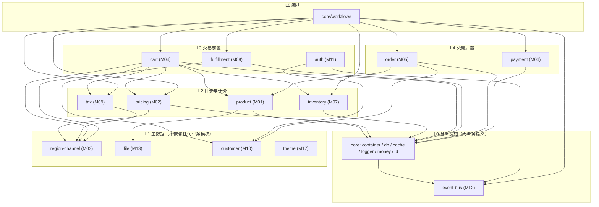
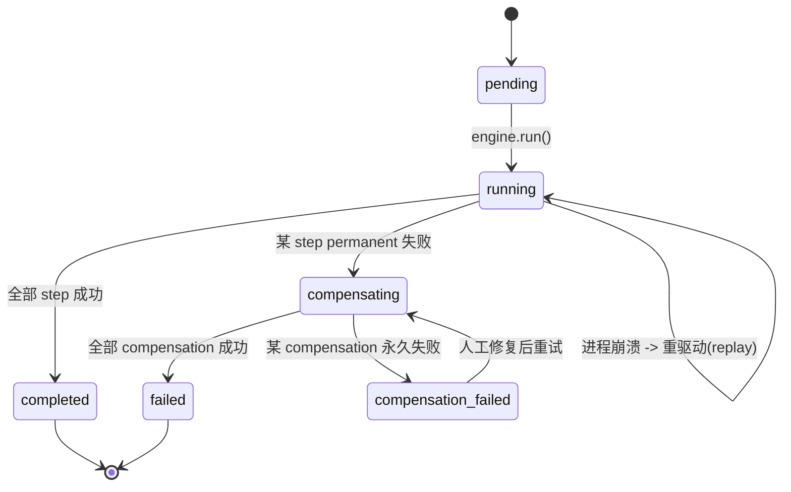

# ARCHITECTURE — 自托管跨境商城（一期 MVP）

| 项 | 值 |
|---|---|
| 文档编号 | docs/02-architecture/ARCHITECTURE.md |
| 版本 | 1.0（Phase 1 定稿） |
| 作者 | 高见远（首席架构师） |
| 上游 | `docs/01-prd/PRD.md`（模块编号 M01–M18 沿用 PRD，不另起一套）、`全球商城项目简报.md` 第三节 13 条架构铁律 |
| 下游消费者 | Phase 2 所有 Spec（前端/后端/DevOps）、`openapi.yaml`、数据库迁移、CI 门禁脚本 |
| 约束力 | 本文档是**契约**，不是建议。凡与本文件冲突的实现一律打回；确需变更，先提 ADR 并改本文档，再改代码 |

---

## 0. 版本锚点（开发启动时按此锁定，禁止凭印象写 API）

下表所有版本号均为 Phase 1 联网实测结果（registry / 官方 release / 官方 versions.json），不是记忆值。开发启动日再核对一次，只允许向上取同一 major 的补丁版。

| 组件 | 锁定版本 | 核查来源 | 备注 |
|---|---|---|---|
| Node.js | **26.13.0**（LTS 代号 Lithium） | `https://nodejs.org/dist/latest-v26.x/SHASUMS256.txt` + `https://github.com/nodejs/Release/blob/main/schedule.json`（v26：LTS 2026-10-28，EOL 2029-04-30） | v24 已于 2026-10-20 转 maintenance，选 v26 Active LTS。若原生依赖（sharp/bcrypt 类）在 26 上装不上，回退 24.x 并在 Spec 记录原因 |
| TypeScript | **7.0.2** | `https://registry.npmjs.org/-/package/typescript/dist-tags`（latest=7.0.2） | 高风险：TS 7 为原生编译器世代，`drizzle-kit`/`vitest`/`ts-node` 兼容性需 POC；不通过则回退 5.9.x 并在 ADR-006 补记 |
| PostgreSQL | **18.6** | `https://www.postgresql.org/versions.json`（major 18：`current: true`，EOL 2030-11-14） | 镜像 `postgres:18.x`；pgvector 用 `pgvector/pgvector:pg18-*`（具体 tag 需 POC，二期才用） |
| Redis | **8.10.3** | `https://api.github.com/repos/redis/redis/releases/latest` | 镜像 `redis:8.10-alpine` |
| pnpm | **12.18.0** | `https://registry.npmjs.org/-/package/pnpm/dist-tags` | 用 corepack 在 `package.json#packageManager` 锁定 |
| Turborepo | **2.11.10** | `https://registry.npmjs.org/-/package/turbo/dist-tags` | 只做任务编排与缓存，不接管构建 |
| Fastify | **5.12.8** | `https://registry.npmjs.org/-/package/fastify/dist-tags` | API 进程 HTTP 层 |
| Zod | **4.6.7** | `https://registry.npmjs.org/-/package/zod/dist-tags` | 请求校验 + OpenAPI 生成唯一来源 |
| drizzle-orm | **0.45.4** | `https://registry.npmjs.org/-/package/drizzle-orm/dist-tags` | 注意：1.0.0-rc.5 已存在但未 GA，**禁止使用 RC** |
| drizzle-kit | **0.31.11** | `https://registry.npmjs.org/-/package/drizzle-kit/dist-tags` | 只用于 `generate` 出 SQL，不用 `push` |
| node-postgres (pg) | **8.23.1** | `https://registry.npmjs.org/-/package/pg/dist-tags` | 驱动，配 PgBouncer |
| ioredis | **6.0.0** | `https://registry.npmjs.org/-/package/ioredis/dist-tags` | 缓存 + 会话 + BullMQ 连接 |
| BullMQ | **6.7.2** | `https://registry.npmjs.org/-/package/bullmq/dist-tags` | Worker 队列 |
| Next.js | **16.4.5** | `https://registry.npmjs.org/-/package/next/dist-tags`（engines: node>=20.9） | 店面 |
| React | **19.3.1** | `https://registry.npmjs.org/-/package/react/dist-tags` | 店面 + 管理后台 |
| Tailwind CSS | **4.3.5** | `https://registry.npmjs.org/-/package/tailwindcss/dist-tags` | v4 为 CSS-first 配置，**不再有 `tailwind.config.js`**（见 §16 坑 7） |
| Vitest | **5.1.0** | `https://registry.npmjs.org/-/package/vitest/dist-tags` | 单测 + 集成测 |
| lucide-react | **1.70.0** | `https://registry.npmjs.org/-/package/lucide-react/dist-tags` | 全项目唯一图标库，见 ADR-010 |
| LangChain.js | **1.6.3** | `https://registry.npmjs.org/-/package/langchain/dist-tags` | 二期 AI Gateway 才引入，一期不装 |
| 参考基线 Medusa | **2.22.4** | `packages/modules/product/package.json`（`https://raw.githubusercontent.com/medusajs/medusa/develop/packages/modules/product/package.json`） | 仅作结构参照，**不引入任何 `@medusajs/*` 依赖** |

未取到可靠版本号、或不宜在此刻写死的项，一律标注「需 POC 验证」，禁止编造：pgvector 具体 tag、微信支付/支付宝 SDK 版本选择（见 ADR-008 备注）、S3 SDK（使用 `@aws-sdk/client-s3` v3 家族，具体 patch 启动时锁定）。

---

## 1. 架构总览

### 1.1 两个进程、五个平面

一期的部署面只有两个 Node 进程（`api`、`worker`）加一个 Next.js 店面进程和一个静态管理后台，全部由同一个 Docker Compose 拉起。逻辑上分五个平面：

```
┌──────────────────────────────────────────────────────────────────────────────┐
│  消费面                                                                       │
│  ┌────────────────────┐   ┌────────────────────┐   ┌──────────────────────┐  │
│  │ apps/storefront     │   │ apps/admin          │   │ 第三方（支付回调）    │  │
│  │ Next.js 16 SSR/ISR  │   │ React 19 SPA        │   │ 微信/支付宝/Stripe    │  │
│  │ /{locale}/{channel} │   │ shadcn/ui           │   │ /PayPal              │  │
│  └─────────┬──────────┘   └─────────┬──────────┘   └───────────┬──────────┘  │
└────────────┼────────────────────────┼──────────────────────────┼─────────────┘
             │ 只走 HTTP（铁律 13）    │                          │
┌────────────▼────────────────────────▼──────────────────────────▼─────────────┐
│  接入面 apps/api（Fastify 5）                                                  │
│  /api/v1/store/*  （publishable key + 可选 customer JWT）                      │
│  /api/v1/admin/*  （admin JWT + RBAC）                                        │
│  横切：请求校验(Zod) / 错误封装 / 幂等键 / 限流 / 请求日志 / OpenAPI 生成        │
└────────────┬──────────────────────────────────────────────────────────────────┘
             │ 只允许调用 workflow.run() 或 单模块 service（铁律 3）
┌────────────▼──────────────────────────────────────────────────────────────────┐
│  编排面 packages/core/workflows（自研 Workflow 引擎）                           │
│  createWorkflow / createStep / StepResponse / transform / when / 补偿栈         │
│  持久化：workflow_execution、workflow_step_execution（可恢复、可重放）           │
└────────────┬──────────────────────────────────────────────────────────────────┘
             │
┌────────────▼──────────────────────────────────────────────────────────────────┐
│  领域面 packages/modules/*（14 个后端模块，模块化单体）                          │
│  product / pricing / region-channel / inventory / cart / order / payment       │
│  fulfillment / tax / customer / auth / file / theme / event-bus                │
│  每个模块：service（业务）+ repository（DAL）+ models（schema）+ migrations      │
│  模块之间零 import：只通过 container.resolve(其他模块 service) 调公开方法        │
└────────────┬──────────────────────────────────────────────────────────────────┘
             │ 跨模块关系只能通过 links 层（铁律 2）
┌────────────▼──────────────────────────────────────────────────────────────────┐
│  关联面 packages/links（自研 links 关联层）                                     │
│  声明式 defineLink → 生成中间表 → 组合式 repository → 查询时批量 join            │
│  禁止：跨模块数据库外键；禁止：A 模块 repository 直查 B 模块表                    │
└────────────┬──────────────────────────────────────────────────────────────────┘
             │
┌────────────▼──────────────────────────────────────────────────────────────────┐
│  Provider 面 packages/providers/*（铁律 5：外部能力一律 Provider 化）           │
│  payment-wechat / payment-alipay / payment-stripe / payment-paypal             │
│  fulfillment-manual / storage-local / storage-s3 / tax-flat                    │
└────────────┬──────────────────────────────────────────────────────────────────┘
             │
┌────────────▼──────────────────────────────────────────────────────────────────┐
│  基础设施面（Compose 内）                                                      │
│  PostgreSQL 18.6（唯一事实来源） / PgBouncer / Redis 8.10.3（缓存+队列+会话）    │
│  本地上传卷（/data/uploads，独立挂载） / 结构化日志（pino → stdout）             │
└──────────────────────────────────────────────────────────────────────────────┘

* notification 为二期预留模块（一期不建 packages/modules/notification），只在本文件 §6 留 Provider 接口签名；
  一期站内通知（写库/日志）由 M12 event-bus 的 subscriber 承载，不接短信/邮件厂商，避免"必填配置不为 0"。
  worker（第二个 Node 进程）与 api 共用同一套 packages/*，只是入口不同：
  worker 订阅 BullMQ 队列 + 进程内事件桥接，不监听 HTTP。
```

### 1.2 十条不可谈判的技术不变式

后续所有 Spec 必须能通过这十条检查，任一条不满足即为架构违规：

1. **模块之间没有 import 关系**。`packages/modules/order` 不许 `import` `packages/modules/payment`；只许 `container.resolve<IPaymentModuleService>("payment")`。ESLint 规则 `no-restricted-imports` 强制（见 §8.4 门禁）。
2. **跨模块不建数据库外键**。允许在表里存对方的 id 列（如 `cart.channel_id text`），但不许 `REFERENCES`。关系在 `packages/links` 声明。
3. **跨模块写操作只能在 workflow 里组合**。service 内部禁止 `await orderService.create()` 之后再 `await inventoryService.reserve()` 这种手写跨模块事务；必须写成一个 workflow，两步各有 compensation。
4. **每条跨模块流程的每个步骤必须有 compensation 或显式声明 `irreversible`**。声明 `irreversible` 的步骤必须在上一步就做前置校验（详见 §5.3）。
5. **所有金额用整数最小币种单位**（`amount_minor BIGINT` + `currency_code CHAR(3)`），代码内禁止 `number` 浮点做金额运算，禁止 `parseFloat`。
6. **所有时间戳用 `timestamptz`，全链路 UTC**，只在店面渲染层按 locale 转时区。
7. **所有表结构变更只能来自 `packages/modules/*/migrations/*.sql`**，且只允许加的增量（`CREATE TABLE` / `CREATE INDEX` / `ADD COLUMN` 且新列 nullable 或有默认值）。破坏性变更必须走 expand-contract 两阶段（见 ADR-009，二期才允许第二阶段）。
8. **店面不写业务逻辑**。`apps/storefront` 里不出现价格计算、库存判断、税费计算、可用支付方式判断；这些必须来自 API。
9. **外部能力只经 Provider 接口**。业务模块里不出现 `fetch("https://api.stripe.com")`、不出现支付厂商 SDK 类型。
10. **每个状态迁移是一张表里的一个显式枚举值**，禁止用 `metadata.status`、禁止用布尔组合表达状态机（Order / Payment / Fulfillment / Refund 四处都是）。

### 1.3 一次「下单并支付」的请求生命周期（把上面的抽象落到一次真实调用）

```
POST /api/v1/store/carts/{id}/complete   (Idempotency-Key: <uuid>)

1. 接入面：Fastify preHandler
   - 校验 x-publishable-key → 解析出 channel
   - 校验 Idempotency-Key：查 idempotency_keys 表（唯一索引），命中直接回放上次响应
   - Zod 校验 body
2. 编排面：workflow.run("complete-cart", { cartId, idempotencyKey })
   step 1  getCartAndValidateStep     （只读，无 compensation）
   step 2  createOrderStep            → order 模块 createOrder()；compensation: cancelOrder(id)
   step 3  reserveInventoryStep       → inventory 模块 createReservation()；compensation: releaseReservation(id)
   step 4  authorizePaymentStep       → payment 模块 authorizePaymentSession()
                                        compensation: cancelAuthorization()（不可逆则声明 irreversible，
                                        并在 step 3 之前先做 authorize，见 §5.3 顺序原则）
   step 5  completeCartStep           → cart 模块 softDelete；compensation: restoreCart(id)
   step 6  emitEventStep              → event-bus.publish("order.placed")（落 outbox，不直接投递）
3. 任一步抛错 → 引擎逆序执行已成功步骤的 compensation → 整个 workflow 标 failed → 返回 409/402
4. 支付回调（异步）
   POST /api/v1/store/webhooks/payment/{provider}/{channel}
   → 验签 → 写入 provider_webhook_event（唯一去重） → 入队 payment-webhook
   → worker 消费 → workflow.run("process-payment-webhook") → 幂等更新 Payment 状态
```

这条链路上没有任何"两步 DB 写在一个事务里跨模块"的代码，也没有任何模块知道另一个模块的表名。

---

## 2. 一期模块边界定义（18 个模块，编号沿用 PRD）

后端运行时模块 14 个（`packages/modules/*`），非运行时交付物 4 个（店面、后台、安装器、可嵌入组件）。PRD 的 M01–M18 编号完整映射如下。

| 编号 | 模块 / 交付物 | 落地位置 | 一句话职责 | 自有数据表（前缀即模块私有） | 允许依赖（只调 service） | 禁止做什么 |
|---|---|---|---|---|---|---|
| M01 | Product | `packages/modules/product` | 商品目录：类型、属性、变体、媒体、slug 与翻译字段 | `product`、`product_variant`、`product_type`、`product_type_attribute`、`attribute`、`attribute_value`、`variant_attribute_value`、`product_image`、`product_category`、`product_category_link` | M13 file（取 URL/派生图） | 不存价格（M02）、不存库存（M07）、不判断可售（渠道归属由 links 决定） |
| M02 | Pricing | `packages/modules/pricing` | 价格集合与价格行：按「币种 × 价格表」定价，不做汇率换算 | `price_set`、`price`、`price_list`、`price_list_rule` | M03 region-channel（校验币种合法） | 不算税（M09）、不算运费（M08）、不存商品信息 |
| M03 | Region + Channel | `packages/modules/region-channel` | 全球化主轴：Region（币种 + 国家集）与 Channel（市场，挂载定价/库存/仓库/税/支付） | `region`、`region_country`、`channel`、`channel_locale`（一期只播 `zh-CN`） | 无 | 不存价格与库存本身（只作为链接的一端）；不做自动汇率 |
| M04 | Cart | `packages/modules/cart` | 购物车：行项目、数量、金额快照、行级税额与运费预留字段 | `cart`、`cart_line_item`、`cart_line_item_adjustment`、`cart_shipping_method` | M01、M02、M03、M07、M09、M10 | 不创建订单（M05）、不发起支付（M06） |
| M05 | Order | `packages/modules/order` | 订单：状态机、行快照（价格/税/属性冻结）、全额退款状态机 | `order`、`order_line_item`、`order_item_snapshot`、`order_shipping_method`、`order_status_history` | M01（只读取展示用字段）、M10、M02（只读快照） | 不扣库存（M07）、不调支付网关（M06，通过 workflow） |
| M06 | Payment | `packages/modules/payment` | 支付：payment session / collection / 交易记录 / 退款记录 / Provider 装载 | `payment_collection`、`payment_session`、`payment`、`payment_transaction`、`refund`、`payment_provider_config`、`provider_webhook_event` | 仅 Provider 接口 | 不改订单状态（由 workflow 调 M05）、不存结账逻辑 |
| M07 | Inventory | `packages/modules/inventory` | 库存：库存项、仓库落位、可用量、预留（reservation）分离 | `inventory_item`、`stock_location`、`inventory_level`、`reservation_item` | 无（与 variant 的关系在 links） | 不判断商品是否上架、不算价格 |
| M08 | Fulfillment | `packages/modules/fulfillment` | 履约：配送 zone、运费方案、发货单、包裹与运单号 | `shipping_zone`、`shipping_option`、`shipping_option_price_rule`、`fulfillment`、`fulfillment_item`、`shipment` | M03（zone 归属）、M05（只接收 order id 列） | 不调承运商真实 API（一期只留 Provider 接口） |
| M09 | Tax | `packages/modules/tax` | 税：Channel 级扁平税率、含税/不含税口径、税行快照 | `tax_rate`、`tax_rate_rule` | 无 | 不做税区自动判定（二期）、不调外部税服务（接口预留） |
| M10 | Customer | `packages/modules/customer` | 客户档案、地址簿、`customer_group`（一期建表不用） | `customer`、`customer_address`、`customer_group` | 无 | 不存密码/凭证（M11）、不存订单 |
| M11 | Auth | `packages/modules/auth` | 凭证与令牌：邮箱密码、refresh token 轮换、admin 角色两档 | `auth_identity`、`auth_credential`、`provider_identity`、`refresh_token`、`admin_user`、`rbac_role`、`rbac_user_role` | M10（注册时建客户档案）、event-bus | 不存客户业务数据、不做权限判断以外的业务逻辑 |
| M12 | Event Bus | `packages/modules/event-bus` | 进程内事件 + outbox + BullMQ 投递 + subscriber 注册表 | `event_outbox`、`subscriber_checkpoint`、`job_dead_letter` | 无 | 不做对外 Webhook（二期 M-Webhook），不承载 workflow 状态 |
| M13 | File | `packages/modules/file` | 文件元数据与存储 Provider 装载、图片派生（多尺寸） | `file`、`file_variant`（派生规格） | 仅 Provider 接口 | 不存业务归属（哪个商品用哪张图由 M01 存 file_id） |
| M17 | Theme | `packages/modules/theme` | 设计变量（主色/字体/圆角/阴影/Logo/商品图比例）单一事实来源 | `theme_settings`、`theme_revision` | 无 | 不存模板代码、不做拖拽装修（二期） |
| M14 | 响应式店面 | `apps/storefront` | Next.js 店面：8 个页面，一套代码覆盖 PC 与 H5 | 无（无数据库访问权） | 只 HTTP 调 Store API | 任何业务逻辑、任何直连数据库、任何直连支付 SDK |
| M15 | 管理后台 | `apps/admin` | React SPA：商品/订单/客户/设置四块 + 设计变量入口 | 无 | 只 HTTP 调 Admin API | 同上；不做 ERP 密集表格 |
| M16 | Installer | `deploy/` | 一键安装：compose 编排、密钥生成、迁移、建管理员、健康检查、自动调参 | 无（写入 `/opt/mall/config`） | 无 | 不把配置写进程序目录、不要求用户手填必填项 |
| M18 | 可嵌入组件 | `packages/ui` | 购物车抽屉、商品画廊、规格选择器做成可独立挂载的组件 | 无 | 无 | 不持有全局状态，不依赖店面路由 |

> M18 的实现约束：这三个组件只接受 props（数据 + 回调），内部不 import `apps/storefront` 的任何模块；这样二期换模板或挂到 AI 客服窗口时可以直接搬。

### 2.1 模块公开 service 契约（只列跨模块可调用的方法）

签名即契约。**列表之外的任何方法都是模块私有，跨模块调用视为违规。**

```ts
// M01 Product
interface IProductModuleService {
  listProducts(q: ProductQuery): Promise<{ items: ProductDTO[]; count: number }>
  retrieveProduct(id: string, opts?: { withVariants?: boolean }): Promise<ProductDTO>
  createProduct(input: CreateProductDTO): Promise<ProductDTO>
  updateProduct(id: string, patch: UpdateProductDTO): Promise<ProductDTO>
  deleteProduct(id: string): Promise<void>                       // 软删
  listVariantsByIds(ids: string[]): Promise<VariantDTO[]>        // 批量，禁止循环调用
  // 目录解析：给定 channel + locale + 过滤条件，返回可售变体（调用 links 组合查询）
  resolveSellableVariants(q: SellableVariantQuery): Promise<{ items: SellableVariantDTO[]; count: number }>
}

// M02 Pricing
interface IPricingModuleService {
  createPriceSet(input: CreatePriceSetDTO): Promise<PriceSetDTO>
  addPrices(priceSetId: string, prices: CreatePriceDTO[]): Promise<void>
  // 唯一计价入口：给 context（currency / channel / quantity / customerGroup），返回每个 variant 的金额
  calculatePrices(input: { variantIds: string[]; context: PricingContext }): Promise<CalculatedPriceDTO[]>
  listPriceLists(q: PriceListQuery): Promise<{ items: PriceListDTO[]; count: number }>
}

// M03 Region + Channel
interface IRegionChannelModuleService {
  getRegion(id: string): Promise<RegionDTO>
  listRegions(): Promise<RegionDTO[]>
  getChannel(id: string): Promise<ChannelDTO>
  getChannelBySlug(slug: string): Promise<ChannelDTO>
  listChannels(q?: { isActive?: boolean }): Promise<ChannelDTO[]>
  assertCurrencyAllowed(channelId: string, currencyCode: string): Promise<void>   // 不合法抛 DomainError
}

// M04 Cart
interface ICartModuleService {
  createCart(input: { channelId: string; regionId: string; customerId?: string; currencyCode: string }): Promise<CartDTO>
  retrieveCart(id: string): Promise<CartDTO>                     // 含行、运费方式
  addLineItem(cartId: string, input: AddLineItemDTO): Promise<CartDTO>
  updateLineItem(cartId: string, lineId: string, patch: { quantity: number }): Promise<CartDTO>
  deleteLineItem(cartId: string, lineId: string): Promise<void>
  setShippingMethod(cartId: string, shippingOptionId: string): Promise<CartDTO>
  applyTotals(cartId: string, totals: CartTotalsDTO): Promise<CartDTO>  // 由 workflow 算好传入
  completeCart(cartId: string): Promise<void>                    // 只做软删 + 标记 completed
  restoreCart(cartId: string): Promise<void>                     // compensation 用
}

// M05 Order
interface IOrderModuleService {
  createOrder(input: CreateOrderDTO): Promise<OrderDTO>          // 行快照在此冻结，之后不再回查目录
  retrieveOrder(id: string): Promise<OrderDTO>
  listOrders(q: OrderQuery): Promise<{ items: OrderDTO[]; count: number }>
  transition(id: string, to: OrderStatus, meta: { actor: string; reason?: string }): Promise<OrderDTO>
  createRefundRequest(orderId: string, input: { amountMinor: bigint; reason: string }): Promise<RefundRequestDTO>
  markRefundSettled(orderId: string, refundRequestId: string): Promise<OrderDTO>
  cancelOrder(id: string): Promise<void>                         // compensation 用
}

// M06 Payment
interface IPaymentModuleService {
  listEnabledProviders(channelId: string): Promise<ProviderDescriptor[]>   // 供店面渲染支付方式
  createPaymentCollection(input: { cartId?: string; orderId?: string; amountMinor: bigint; currencyCode: string }): Promise<PaymentCollectionDTO>
  createSession(input: { paymentCollectionId: string; providerId: string; context: PaymentContext }): Promise<PaymentSessionDTO>
  authorizeSession(sessionId: string): Promise<PaymentDTO>
  capturePayment(paymentId: string, amountMinor: bigint): Promise<PaymentDTO>
  refundPayment(input: { paymentId: string; amountMinor: bigint; reason?: string; idempotencyKey: string }): Promise<RefundDTO>
  cancelPayment(paymentId: string): Promise<void>
  handleProviderWebhook(providerId: string, raw: ProviderWebhookPayload): Promise<{ action: WebhookAction; data?: unknown }>
}

// M07 Inventory
interface IInventoryModuleService {
  getAvailability(input: { variantIds: string[]; locationIds?: string[] }): Promise<AvailabilityDTO[]>
  reserve(input: { variantId: string; locationId: string; quantity: number; lineItemId: string; workflowRunId: string }): Promise<ReservationDTO>
  releaseReservation(reservationId: string): Promise<void>
  commitReservation(reservationId: string): Promise<void>          // 发货时把预留转为真实出库
  adjustLevel(input: { inventoryItemId: string; locationId: string; delta: number; reason: string }): Promise<InventoryLevelDTO>
}

// M08 Fulfillment
interface IFulfillmentModuleService {
  listShippingOptions(input: { channelId: string; countryCode: string; cartSubtotalMinor: bigint; weightGram?: number }): Promise<ShippingOptionDTO[]>
  calculateShippingPrice(optionId: string, ctx: ShippingPriceContext): Promise<{ amountMinor: bigint; currencyCode: string }>
  createFulfillment(input: { orderId: string; items: FulfillmentItemInput[] }): Promise<FulfillmentDTO>
  addShipment(fulfillmentId: string, input: { carrierName: string; trackingNumber: string; shippedAt: Date }): Promise<ShipmentDTO>
}

// M09 Tax
interface ITaxModuleService {
  getRateForChannel(channelId: string): Promise<TaxRateDTO>        // 一期：扁平税率
  calculateTax(input: { channelId: string; lines: TaxLineInput[]; shippingMinor: bigint; pricesIncludeTax: boolean }): Promise<TaxResultDTO>
}

// M10 Customer
interface ICustomerModuleService {
  createCustomer(input: { email: string; firstName?: string; lastName?: string; phone?: string }): Promise<CustomerDTO>
  retrieveCustomer(id: string): Promise<CustomerDTO>
  retrieveCustomerByEmail(email: string): Promise<CustomerDTO | null>
  listAddresses(customerId: string): Promise<AddressDTO[]>
  addAddress(customerId: string, input: AddressInput): Promise<AddressDTO>
  deleteCustomer(id: string): Promise<void>                        // compensation 用
}

// M11 Auth
interface IAuthModuleService {
  register(input: { email: string; password: string; profile?: ProfileInput }): Promise<{ identityId: string; customerId: string }>
  authenticate(input: { email: string; password: string; scope: "customer" | "admin" }): Promise<TokenPair>
  refresh(refreshToken: string): Promise<TokenPair>                // 轮换，旧 token 立即失效
  revoke(refreshToken: string): Promise<void>
  verifyAccessToken(token: string): Promise<AuthContext>           // { sub, scope, roles[] }
  assertPermission(ctx: AuthContext, permission: Permission): void
}

// M12 Event Bus
interface IEventBusModuleService {
  publish(event: DomainEvent, opts?: { tx?: DbTx }): Promise<void>  // 同事务写 outbox
  registerSubscriber(name: string, handler: SubscriberHandler): void
}

// M13 File
interface IFileModuleService {
  upload(input: { stream: Readable; filename: string; contentType: string; byteLength: number }): Promise<FileDTO>
  retrieve(id: string): Promise<FileDTO>
  getPublicUrl(id: string, variant?: ImageVariant): Promise<string>
  delete(id: string): Promise<void>
}

// M17 Theme
interface IThemeModuleService {
  getSettings(): Promise<ThemeSettingsDTO>
  updateSettings(patch: Partial<ThemeSettingsDTO>): Promise<ThemeSettingsDTO>   // 写 revision 留痕
  getPublishedTokens(): Promise<{ cssText: string; version: number }>           // 店面注入用
}
```

### 2.2 明确「不做」的边界（防止镀金，spec-as-contract 强制项）

本期架构**不覆盖**以下范围，Spec 出现相关内容一律打回：

- 多商户 / Marketplace 维度（宪章级永不做）
- 部分退款、退货单（RMA）、换货（二期 K4）
- 多仓调拨、跨仓分配策略（只保留数据模型与「按优先级」一种策略，二期 K1）
- 承运商真实 API 对接、轨迹同步、面单打印（二期 K2）
- 税区自动判定、多税率、外部税务服务（二期 K3）
- 对外 Webhook 投递层、API Key、事件回放（二期 K6）
- 第三方登录、短信验证码、SSO（二期 K7）
- Notification/SMS 真实服务商接入（一期只留 Provider 接口 + 后台配置，不接任何短信/邮件厂商；手机号仅作软标识，见 §6.0）
- 电子发票服务商（一期不接，后台配置占位，见 §6.0）
- 搜索专用引擎（一期用 PostgreSQL 全文检索兜底，二期换 Meilisearch）
- AI Gateway / AI 客服（二期，一期不装 LangChain 依赖）
- 拖拽装修、多模板、后台一键升级（二期）
- GraphQL、gRPC、消息中间件（Kafka/RabbitMQ）、MySQL、Go/Java 服务（技术栈已锁定，禁止引入）

---

## 3. 模块依赖图（必须无环）

箭头方向 = 「依赖方向」（A → B 表示 A 调用 B 的 service）。**所有跨模块的写操作组合只允许出现在 `packages/core/workflows`，不在任何模块内。**



无环论证：分层编号 L0 < L1 < L2 < L3 < L4 < L5，所有边只从高编号指向低编号；`order` 不依赖 `payment`（payment 由 workflow 驱动，order 只存 `payment_collection_id` 列）；`payment` 不依赖 `order`；`inventory` 不依赖 `product`（variant 关系在 links 层）。CI 用 `scripts/check-module-graph.ts` 解析 import 图做拓扑检测，出现环或跨层反向依赖即失败。

### 3.1 为什么「order 不依赖 payment」

订单状态机的「已支付」由**支付事件**驱动，不由 payment 模块调用 order 的方法实现。链路是：

```
支付网关回调 → provider_webhook_event（去重） → 队列 payment-webhook
  → workflow "process-payment-webhook"
    → step: payment.handleProviderWebhook() 得到 { action: AUTHORIZED, data }
    → step: order.transition(orderId, "paid")
    → step: inventory.commitReservation(...)
    → step: event-bus.publish("order.paid")
```

这样 payment 与 order 谁也不依赖谁，加一个新的支付厂商只影响 provider 包与 webhook 解析，不动 order。

---

## 4. links 关联层设计

### 4.1 为什么自研 links，而不是直接开外键

铁律 2 的要求是「替换单个模块的影响面只限本模块 + 调用它的 workflow」。若 `order` 表对 `payment` 表建外键，则删改 payment 表结构会连带锁住 order 的迁移，模块边界立刻失效。Medusa v2 的做法是：**模块内保留对方的 id 列（无外键约束），关系在 links 层声明并生成独立中间表**（证据：`packages/modules/link-modules/src/definitions/product-sales-channel.ts` 中 `databaseConfig.tableName = "product_sales_channel"`、`primaryKeys: ["id", "product_id", "sales_channel_id"]`、`extends[]` 把关系反向挂到 Product 实体上）。本项目照此结构自研，不引入其包。

### 4.2 三类关系，三种落地方式（这是本层的核心规则）

| 关系类型 | 例子 | 存法 | 为什么 |
|---|---|---|---|
| **A. 归属型（一方是另一方的配置）** | cart 属于 channel；order 属于 customer | 在**从属方**表内存 id 列（`cart.channel_id text NOT NULL`），**不建外键**，links 层只声明关系供查询 join，不生成中间表 | 一个 cart 只有一个 channel，建中间表纯属浪费 |
| **B. 多对多型** | product ↔ channel（商品可投放到多个市场）；inventory_level ↔ channel | links 层生成**独立中间表**，双列联合唯一 | 关系本身有生命周期与自定义列（如 `product_channel.is_visible`、排序） |
| **C. 装配型（连接两个模块的实体但语义在第三方）** | product_variant ↔ price_set；inventory_item ↔ product_variant | links 层生成中间表，且删除时由**调用方 workflow 显式 dismiss**（不级联） | 价格集合属于 pricing，变体属于 product，谁也不能替对方决定删除 |

### 4.3 关联表清单（一期全部）

命名规范：`link_<左实体复数>__<右实体复数>`，`id` 前缀 `lnk_`，主键为 ULID，另有 `created_at`、`updated_at`、`deleted_at`（软删，供 dismiss 语义用）。

| 表名 | 左（模块.表.字段） | 右（模块.表.字段） | 基数 | 唯一约束 | 索引 | 删除语义 | 自定义列 |
|---|---|---|---|---|---|---|---|
| `product_channel` | product.product.id | region-channel.channel.id | N:N | `(product_id, channel_id)` WHERE deleted_at IS NULL | `(channel_id, product_id)` | **restrict**：删 channel 前必须由 workflow 解除全部投放 | `is_visible bool default true`、`sort_order int` |
| `variant_price_set` | product.product_variant.id | pricing.price_set.id | N:1 | `(variant_id)` 唯一 | `(price_set_id)` | **dismiss**：删变体时 workflow 显式调用；price_set 保留以便审计 | 无 |
| `price_list_channel` | pricing.price_list.id | region-channel.channel.id | N:N | `(price_list_id, channel_id)` | `(channel_id)` | restrict | 无 |
| `inventory_item_variant` | inventory.inventory_item.id | product.product_variant.id | 1:1 | `(variant_id)` 唯一、`(inventory_item_id)` 唯一 | 两列各一 | dismiss | 无 |
| `stock_location_channel` | inventory.stock_location.id | region-channel.channel.id | N:N | `(stock_location_id, channel_id)` | `(channel_id)` | restrict | 无 |
| `shipping_option_channel` | fulfillment.shipping_option.id | region-channel.channel.id | N:N | `(shipping_option_id, channel_id)` | `(channel_id)` | restrict | 无 |
| `payment_provider_channel` | payment.payment_provider_config.id | region-channel.channel.id | N:N | `(provider_config_id, channel_id)` | `(channel_id)` | restrict | `is_enabled bool`、`sort_order int` |
| `tax_rate_channel` | tax.tax_rate.id | region-channel.channel.id | N:1 | `(channel_id)` 唯一（一期一渠道一税率） | `(tax_rate_id)` | restrict | 无 |
| `order_payment_collection` | order.order.id | payment.payment_collection.id | 1:1 | `(order_id)` 唯一 | `(payment_collection_id)` | **cascade**：删订单时删支付集合与其交易（仅在订单从未支付成功时允许） | 无 |
| `order_fulfillment` | order.order.id | fulfillment.fulfillment.id | 1:N | 无（一个订单可拆多个包裹） | `(order_id)`、`(fulfillment_id)` | cascade（同上条件下） | 无 |
| `cart_customer` | cart.cart.id | customer.customer.id | N:1 | `(cart_id)` 唯一 | `(customer_id)` | dismiss（游客车无此行） | 无 |
| `order_customer` | order.order.id | customer.customer.id | N:1 | `(order_id)` 唯一 | `(customer_id)` | restrict（有订单的客户禁止硬删，只软删） | 无 |
| `product_image_file` | product.product_image.id | file.file.id | N:1 | `(product_image_id)` 唯一 | `(file_id)` | dismiss（删图时先删 file 再 dismiss） | 无 |

**规则 4 条，写进 ESLint/迁移检查**：
1. 关联表禁止出现 `REFERENCES`（迁移 SQL lint 拦截）。
2. 关联表禁止存业务字段（只许 `id`/两列 id/时间戳/`is_*` 与 `sort_order` 这类关系属性）。业务字段必须在模块自己的表里。
3. 同一个关系只允许一张关联表，禁止"影子中间表"。
4. 删除语义只有三种：`restrict`（默认）、`dismiss`（调用方显式）、`cascade`（仅限 1:1 且生命周期完全从属，且必须在此表登记理由）。

### 4.4 实现结构（自研，约 600 行）

```
packages/core/src/links/
├── define-link.ts          # defineLink({ table, left, right, cardinality, onDelete, columns })
├── link-registry.ts        # 启动时收集全部定义，校验：表名唯一、字段存在、无循环级联
├── link-repository.ts      # create / dismiss / delete / restore / listByLeft / listByRight / batchGet
├── query-composer.ts       # 把「主查询 + 若干 link」编译成一条带 LEFT JOIN 的 SQL（禁止 N+1）
└── types.ts
```

关键约束：`query-composer` 是**唯一**允许跨模块读的地方，且它只 join 关联表与对方模块声明的 `linkable` 字段白名单，不 join 对方私有表。查询形态固定为：

```ts
// 一次查询拿齐，禁止在循环里 resolve
const rows = await query.compose({
  entity: "product",
  fields: ["id", "title", "variants.id", "variants.prices.amount_minor"],
  filters: { channel_id: ch.id, is_visible: true },
  limit: 20, offset: 0,
})
```

生成 SQL 的形态（示意，实际由 composer 拼）：

```sql
SELECT p.id, p.title, v.id AS variant_id, pr.amount_minor
FROM product p
LEFT JOIN product_variant v ON v.product_id = p.id AND v.deleted_at IS NULL
LEFT JOIN variant_price_set lk1 ON lk1.variant_id = v.id AND lk1.deleted_at IS NULL
LEFT JOIN price pr ON pr.price_set_id = lk1.price_set_id AND pr.currency_code = $1
LEFT JOIN product_channel lk2 ON lk2.product_id = p.id AND lk2.deleted_at IS NULL
WHERE lk2.channel_id = $2 AND lk2.is_visible AND p.deleted_at IS NULL
ORDER BY p.created_at DESC LIMIT $3 OFFSET $4;
```

> 一期不做「跨模块分布式查询」，`query-composer` 只支持单库内的 join。未来拆库时，这一层就是替换点（ADR-003）。

---

## 5. Workflow 引擎规范（全项目最高风险项）

### 5.1 选型结论与理由摘要（详见 ADR-002）

自研「**顺序步骤 + 补偿栈 + 步骤日志（journal）+ 重放（replay）**」的最小引擎，约 700–900 行，不引入 XState、不做事件溯源、不做并行分支、不做声明式 DAG 编译。

放弃 Medusa 那套声明式模型的理由，来自它的源码形态：`createWorkflow(id, (input: WorkflowData<T>) => {...})` 里 `input` 是**惰性代理**，`transform()` 声明依赖、`parallelize()` 与 `when().then()` 组成 DAG，运行时引擎再把图编译成执行计划（见 `packages/core/core-flows/src/order/workflows/create-order.ts`，内部 6 处 `transform`、1 处 `parallelize`、2 处 `when`）。这套机制换来并行与声明式重放，但代价是：类型体操极重、错误栈难读、调试要靠引擎日志、自研成本 ≥ 2 周。**一期不需要并行步骤**，用命令式 + journal 能拿到同样的"可恢复、可补偿、可测试"，成本降到 1/4。

**一期的能力边界（明确不做）**：无 `parallelize`、无 DAG、无声明式 `transform`（普通 TS 代码即可）、无嵌套子 workflow 并行执行（嵌套只支持 `await` 顺序调用）、无 hook 机制（二期用 subscriber + 自定义 step 组合实现同等能力）。

### 5.2 编程模型（四个原语，全部）

```ts
// ---------- 原语 1：step ----------
export interface StepDefinition<TInput, TOutput, TCompensate = void> {
  id: string                                          // 全局唯一，写入 journal 作为幂等键的一部分
  invoke(input: TInput, ctx: StepContext): Promise<StepResponse<TOutput, TCompensate>>
  compensate?(payload: TCompensate, ctx: StepContext): Promise<void>
  retry?: { maxAttempts: number; baseMs: number; maxMs: number; jitter: boolean }
  timeoutMs?: number                                  // 默认 10_000，超时按 TransientError 处理
}

// ---------- 原语 2：返回值（把补偿所需的数据显式带出来）----------
export class StepResponse<TOutput, TCompensate = void> {
  constructor(readonly output: TOutput, readonly compensateInput?: TCompensate) {}
  static permanentFailure(message: string, compensateInput?: unknown): never
}

// ---------- 原语 3：workflow 定义 ----------
export function createWorkflow<TInput, TOutput>(def: {
  id: string
  input: ZodType<TInput>
  timeoutMs?: number                                   // 默认 30_000，与 HTTP 请求生命周期对齐
}, body: (ctx: WorkflowContext, input: TInput) => Promise<TOutput>): Workflow<TInput, TOutput>

// ---------- 原语 4：执行上下文（唯一允许访问 step 的入口）----------
export interface WorkflowContext {
  readonly executionId: string
  readonly idempotencyKey: string                      // 由调用方传入或自动生成
  readonly logger: Logger
  step<TIn, TOut, TComp>(s: StepDefinition<TIn, TOut, TComp>, input: TIn): Promise<TOut>
  emit(event: DomainEvent): Promise<void>              // 写 outbox，不阻塞主流程
  resolve<T>(name: ModuleName): T                      // 只用于补偿步骤内部取 service
}
```

一次真实调用（`complete-cart`，一期最关键的一条）：

```ts
export const completeCartWorkflow = createWorkflow(
  { id: "complete-cart", input: CompleteCartInput },
  async (ctx, input) => {
    // 只读校验，无副作用，无 compensation
    const cart = await ctx.step(getCartStep, { cartId: input.cartId })

    // 先算钱（纯计算，无副作用），避免"先写库后算错"
    const totals = await ctx.step(calculateTotalsStep, { cart })

    // 有副作用步骤，按"可逆 -> 可对冲 -> 不可逆"顺序排列
    const order = await ctx.step(createOrderStep, { cart, totals })
    //   compensate: cancelOrder(order.id)
    const reservations = await ctx.step(reserveInventoryStep, { order })
    //   compensate: releaseReservations(ids)
    const payment = await ctx.step(authorizePaymentStep, { order, sessionId: cart.paymentSessionId })
    //   compensate: cancelAuthorization(payment.id)   ← 属于"可对冲"，见 §5.3

    await ctx.step(completeCartStep, { cartId: cart.id })
    //   compensate: restoreCart(cartId)

    await ctx.emit({ name: "order.placed", data: { orderId: order.id } })
    return order
  }
)
```

调用方式（在 API 路由里，这是路由层唯一允许做的事）：

```ts
const { result, executionId } = await container
  .resolve<WorkflowEngine>("workflowEngine")
  .run(completeCartWorkflow, { cartId, idempotencyKey: idemKey })
```

### 5.3 compensation 语义边界（三类，必须在上线前逐步骤标注）

这是 OPEN-DECISIONS 第 4 条要求的定义，本节即为其答复。

| 类别 | 定义 | 一期属于此类的步骤 | compensation 的真实含义 | 硬规则 |
|---|---|---|---|---|
| **R — 可逆** | 补偿是**确定性回滚**，完成后系统状态回到 invoke 之前的等价状态 | createOrder / reserveInventory / completeCart / createPaymentCollection / uploadFile 元数据 | `delete` / `cancel` / `restore` 本地记录 | 必须写自动化测试验证"回滚后行数回到基线" |
| **X — 可对冲** | 补偿不是回滚，而是**发起一笔反向业务**；资金或实物已动，只能对冲 | authorizePayment / capturePayment / refundPayment / addShipment | 取消授权（void）/ 退款 / 作废运单 | 必须传幂等键给网关（§5.6）；必须验证对冲结果，不能只发请求 |
| **I — 不可逆** | 没有对冲手段 | 发送短信/邮件、推送、删除已备份的物理对象 | 无 | **禁止出现在 workflow 中段**。只能作为最后一步，或移出 workflow 改为 subscriber 异步执行（允许失败、可重试） |

**顺序原则（validate early, mutate late）**，写进 Step 编写规范：

1. 所有只读校验（库存是否够、价格是否变、渠道是否支持该支付方式、地址是否在配送 zone 内）放在**最前面**，一次做完。
2. 有副作用的 R 类步骤集中在中间。
3. X 类（资金）步骤放在 R 类之后、I 类之前。理由：资金动作一旦发生，后续 R 类步骤若失败，补偿链要"退款 + 删订单"两步都成功，风险敞口大；反过来先建订单再扣款，失败时只需取消授权。
4. I 类永远最后，或干脆移出。

### 5.4 状态机与持久化（内核自有三张表）



```sql
-- 内核表 1：一次执行
CREATE TABLE workflow_execution (
  id                text PRIMARY KEY,                    -- wf_<ulid>
  workflow_id       text NOT NULL,
  status            text NOT NULL,                       -- pending|running|completed|failed|compensating|compensation_failed
  idempotency_key   text NOT NULL,
  input             jsonb NOT NULL,
  output            jsonb,
  error             jsonb,                               -- { code, message, stepId, stack? }
  attempt           int  NOT NULL DEFAULT 1,
  parent_execution  text,                                -- 嵌套调用时记录父执行
  started_at        timestamptz NOT NULL DEFAULT now(),
  finished_at       timestamptz,
  heartbeat_at      timestamptz NOT NULL DEFAULT now()
);
CREATE UNIQUE INDEX uq_wf_exec_idem ON workflow_execution (workflow_id, idempotency_key);
CREATE INDEX idx_wf_exec_stale ON workflow_execution (status, heartbeat_at)
  WHERE status IN ('running', 'compensating');

-- 内核表 2：步骤日志（既做幂等，也做重放，也做补偿栈）
CREATE TABLE workflow_step_execution (
  id                    text PRIMARY KEY,
  execution_id          text NOT NULL REFERENCES workflow_execution(id),  -- 同模块内允许外键
  step_id               text NOT NULL,
  seq                   int  NOT NULL,                   -- 递增，补偿时倒序
  status                text NOT NULL,                   -- running|completed|failed|compensated|compensation_failed
  input                 jsonb,
  output                jsonb,
  compensate_input      jsonb,                           -- 即 StepResponse 的第二参数
  attempts              int NOT NULL DEFAULT 0,
  error                 jsonb,
  started_at            timestamptz NOT NULL DEFAULT now(),
  finished_at           timestamptz,
  compensated_at        timestamptz
);
CREATE UNIQUE INDEX uq_wf_step ON workflow_step_execution (execution_id, step_id);
CREATE INDEX idx_wf_step_compensable ON workflow_step_execution (execution_id, seq DESC)
  WHERE compensate_input IS NOT NULL AND compensated_at IS NULL;

-- 内核表 3：API 层幂等键（供 POST 类接口回放）
CREATE TABLE idempotency_keys (
  scope          text NOT NULL,      -- e.g. 'store:cart.complete'
  key            text NOT NULL,
  request_hash   text NOT NULL,      -- body 哈希，防同键不同体
  status_code    int,
  response_body  jsonb,
  created_at     timestamptz NOT NULL DEFAULT now(),
  expires_at     timestamptz NOT NULL
);
CREATE UNIQUE INDEX uq_idem ON idempotency_keys (scope, key);
```

**崩溃恢复（re-drive）**：worker 启动后与每 30 秒，扫描 `status IN ('running','compensating') AND heartbeat_at < now() - interval '60 seconds'`，对每条执行**重新调用 `engine.run()`**。安全性来自 `ctx.step()` 的重放语义（§5.5）：已 `completed` 的步骤直接返回日志里的 `output`，不会二次执行；`compensating` 的执行则继续走完补偿栈。

### 5.5 引擎核心循环（实现草案，可直接照着写）

```ts
export class WorkflowEngine {
  constructor(private deps: { db: Db; registry: WorkflowRegistry; logger: Logger; clock: Clock }) {}

  async run<TOut>(wf: Workflow<any, TOut>, input: unknown, opts: RunOptions): Promise<RunResult<TOut>> {
    const idem = opts.idempotencyKey ?? `auto_${ulid()}`
    const exec = await this.deps.db.tx(async (tx) => {
      const existing = await repo.findExecution(tx, wf.id, idem)
      if (existing) return existing                        // 幂等：同键直接拿旧执行
      return repo.insertExecution(tx, { id: `wf_${ulid()}`, workflowId: wf.id, idempotencyKey: idem, input })
    })

    if (exec.status === "completed") return { result: exec.output as TOut, executionId: exec.id }
    if (exec.status === "failed" || exec.status === "compensation_failed") {
      throw new WorkflowFailedError(exec.error, exec.id)
    }

    await repo.setStatus(this.deps.db, exec.id, "running")
    const ctx = this.buildContext(wf, exec)

    try {
      const result = await withTimeout(wf.body(ctx, input), wf.timeoutMs ?? 30_000)
      await repo.complete(this.deps.db, exec.id, result)
      return { result, executionId: exec.id }
    } catch (err) {
      await this.compensate(exec.id, err)                  // 见下
      throw new WorkflowFailedError(toErrorPayload(err), exec.id)
    }
  }

  /** ctx.step 的实现：run-or-replay，是整套机制的心脏 */
  private async step<TIn, TOut, TComp>(
    exec: ExecutionRow, s: StepDefinition<TIn, TOut, TComp>, input: TIn
  ): Promise<TOut> {
    const existing = await repo.findStep(this.deps.db, exec.id, s.id)
    if (existing?.status === "completed") return existing.output as TOut   // 重放，不执行

    const seq = await repo.nextSeq(this.deps.db, exec.id)
    await repo.upsertStepRunning(this.deps.db, { executionId: exec.id, stepId: s.id, seq, input })

    const policy = s.retry ?? { maxAttempts: 3, baseMs: 200, maxMs: 5_000, jitter: true }
    let lastErr: unknown
    for (let attempt = 1; attempt <= policy.maxAttempts; attempt++) {
      try {
        const resp = await withTimeout(
          s.invoke(input, { ...this.stepCtx(exec), attempt, idempotencyKey: `${exec.id}:${s.id}` }),
          s.timeoutMs ?? 10_000
        )
        await repo.completeStep(this.deps.db, exec.id, s.id, resp.output, resp.compensateInput, attempt)
        return resp.output
      } catch (err) {
        lastErr = err
        await repo.recordStepFailure(this.deps.db, exec.id, s.id, err, attempt)
        if (!isRetryable(err) || attempt === policy.maxAttempts) break
        await sleep(backoff(policy, attempt))
      }
    }
    throw lastErr                                            // 抛出即触发整条补偿链
  }

  /** 补偿：倒序、幂等、可重试；失败进 compensation_failed + 死信 + 告警 */
  private async compensate(executionId: string, cause: unknown): Promise<void> {
    await repo.setStatus(this.deps.db, executionId, "compensating")
    const rows = await repo.listCompensableDesc(this.deps.db, executionId)  // seq DESC
    for (const row of rows) {
      const step = this.deps.registry.getStep(row.stepId)
      if (!hasCompensation(step)) {                           // 声明为 I 类且无补偿
        if (row.compensateInput != null) {
          await repo.markCompensationFailed(row.id, new Error(`step ${row.stepId} missing compensate`))
          return this.deadLetter(executionId, row.stepId, "missing_compensation")
        }
        continue
      }
      try {
        await withRetry(() => step.compensate!(row.compensateInput, this.stepCtxById(executionId)),
          { maxAttempts: 5, baseMs: 500, maxMs: 30_000 })
        await repo.markCompensated(this.deps.db, row.id)
      } catch (err) {
        await repo.markCompensationFailed(row.id, err)
        await this.deadLetter(executionId, row.stepId, "compensation_failed")
        await repo.setStatus(this.deps.db, executionId, "compensation_failed")
        this.deps.logger.error({ executionId, stepId: row.stepId, cause, err }, "compensation_failed")
        return                                               // 停止继续补偿，保留现场交付人工
      }
    }
    await repo.setStatus(this.deps.db, executionId, "failed")
    this.deps.logger.warn({ executionId, cause }, "workflow_failed_and_compensated")
  }
}
```

三条实现纪律：

1. `ctx.step()` 里**只有一处**能调 `s.invoke`。任何绕过它直接 `await someService.xxx()` 的代码都不在 journal 里，崩溃后无法恢复、失败后无法补偿——因此 `ctx` 之外不暴露 `resolve`，业务代码拿不到 service（编译期即阻断）。
2. 步骤内的外部调用必须传 `ctx.idempotencyKey`（=`${executionId}:${stepId}`），网关侧据此去重。重放时即使 invoke 被触发第二次，网关也不会重复扣款。
3. 补偿函数**不能依赖内存状态**，只能依赖 `compensateInput`。这是补偿能跨进程恢复的前提。

### 5.6 幂等要求（三层，缺一层就有重复扣款风险）

| 层 | 键 | 存储 | 作用 |
|---|---|---|---|
| API 层 | `Idempotency-Key` 请求头 + `scope` | `idempotency_keys` 唯一索引 | 用户重复点"提交订单"回放上次响应 |
| 引擎层 | `(workflow_id, idempotency_key)` | `workflow_execution` 唯一索引 | 同一次业务意图只创建一条执行 |
| 步骤层 | `${executionId}:${stepId}` | `workflow_step_execution` 唯一索引 + 传给网关 | 崩溃重放不重复执行副作用；网关侧去重 |

网关侧幂等键映射（**必须实测**，见 §12 风险 R4）：

| Provider | 幂等参数 | 备注 |
|---|---|---|
| 微信支付 APIv3 | `out_trade_no`（下单）、`out_refund_no`（退款） | 只能由商户生成；必须用确定性派生（如 `ord_<ulid>` / `rfd_<ulid>`），不能含随机数 |
| 支付宝 | `out_trade_no` / `out_request_no`（退款） | 同上 |
| Stripe | 请求头 `Idempotency-Key` | 官方支持，24 小时后失效 |
| PayPal | 请求头 `PayPal-Request-Id` | 官方支持 |

### 5.7 失败重试与死信

| 错误类别 | 判定 | 是否重试 | 例子 |
|---|---|---|---|
| `DomainError` | 显式抛出的业务错误（`code` 前缀 `2xxxx`/`4xxxx`） | 否，立即永久失败 | 库存不足、价格已变、渠道不支持该支付方式 |
| `TransientError` | 网络错误、超时、网关 5xx、`ECONNRESET` | 是，按 step 的 `retry` 策略（默认 3 次，指数退避 + 抖动） | 支付网关超时 |
| `UnknownError` | 其他 | 重试 1 次后永久失败 | 代码 bug、空指针 |
| `permanentFailure()` | `StepResponse.permanentFailure()` 主动触发 | 否，但**会把已积累的 `compensateInput` 带出去** | 循环里第 3 个商品失败，前 2 个的预留要能释放（对齐 Medusa 文档里的 `permanentFailure` 用法） |

死信表（`job_dead_letter`，落在 event-bus 模块，引擎通过 `container.resolve("eventBus")` 写入，避免内核直连模块表）：

```sql
CREATE TABLE job_dead_letter (
  id            text PRIMARY KEY,
  kind          text NOT NULL,          -- 'workflow' | 'queue_job' | 'compensation'
  ref_id        text NOT NULL,          -- executionId / jobId
  step_id       text,
  payload       jsonb NOT NULL,
  error         jsonb NOT NULL,
  attempts      int NOT NULL,
  created_at    timestamptz NOT NULL DEFAULT now(),
  resolved_at   timestamptz,
  resolved_by   text
);
```
一期的运维界面只做「看 + 标记已处理」，不做自动重放（二期 System Update 时一起做）。

### 5.8 如何测试补偿（三层，全部要有一期落地）

| 层 | 测什么 | 怎么测 | 数量目标 |
|---|---|---|---|
| L1 契约测试（单 step） | 每个带 compensation 的 step：先 `invoke` 成功，再单独执行 `compensate(compensateInput)` 不抛错，且断言数据库回基线 | 每个 step 一个 `*.compensate.spec.ts`，用 `withTestDb()` 每次开新 schema | 一期约 14 个（R 类步骤全覆盖） |
| L2 故障注入（整条 workflow） | 在第 N 步注入失败，断言：前 N-1 步全部补偿、`workflow_execution.status='failed'`、外部假 Provider 的 `cancel/refund` 被调用、关键表行数回到基线 | `faultInject.at("create-order", { throwAfterInvoke: true })`；配 `FakePaymentProvider` 记录调用序列 | 每条跨模块 workflow 至少 2 个用例（中段失败 + 末段失败） |
| L3 网关韧性（真沙箱） | 回调重复投递、乱序投递、回调先于同步返回到达、补偿时网关超时后重试 | 用沙箱或本地 fake 发送同一 webhook 3 次；断言 `provider_webhook_event` 只处理一次、订单状态只迁移一次 | 每个支付 Provider 至少 1 组 |

L2 是必过的门禁：`pnpm test:workflow` 失败则不许合并。这一条直接对应知识库 `generated-code-failure-modes` 的"沉默逻辑错误"防线——补偿写错不会报错，只会悄悄漏掉回滚。

### 5.9 workflow 的启用边界（防止把什么流程都塞进引擎）

**必须是 workflow 的**：任何跨 ≥2 个模块的写操作（下单、支付授权、回调处理、退款、发货、取消订单、库存预留转出库）。

**必须是单模块 service 的**：单模块内的 CRUD（创建商品、改价格、加地址）。给它们套 workflow 只会增加 journal 表和日志噪音。

**必须是队列任务的**：耗时 > 1 秒或允许最终一致的副作用（图片派生、发邮件、搜索索引更新、AI 向量化）。它们从 subscriber 里入队，不进 workflow——因为 workflow 与 HTTP 请求同生命周期，不能挂着 30 秒。

判定口诀：**跨模块 → workflow；单模块 → service；耗时长 → 队列。**

---

## 6. Provider 接口清单

### 6.0 Provider 一期落地口径（全局规则）

> **全局规则**：所有依赖外部服务商的能力，一律 Provider 化 + 后台配置入口；**一期不接真实服务商，只留接口 + Fake/内置实现 + 后台配置项**。唯一例外：支付四家 Provider 沙箱全做（这是用户定案）。这条规则与铁律 5、ADR-008 互为约束，Spec 阶段任何"一期就接某家真实服务商"的提法一律打回。

| Provider 类别 | 一期实现 | 一期状态 |
|---|---|---|
| Payment 支付 | 微信支付 / 支付宝 / Stripe / PayPal 四家沙箱全做 + FakePaymentProvider 兜底 | 全做（唯一例外，沙箱级） |
| Fulfillment 履约承运商 | ManualFulfillmentProvider（手工填快递公司 + 单号） | 不接真实承运商 API，轨迹同步二期（只留接口） |
| Tax 税务 | FlatTaxProvider（Channel 级扁平税率） | 不接外部税计算服务（只留接口） |
| Storage 存储 | LocalStorageProvider（本地，默认开箱可用） | S3 兼容对象存储只留接口 + 后台配置，不填即本地 |
| Notification/SMS 通知 | LogNotificationProvider（写库 + 日志） | 不接任何短信/邮件服务商（只留接口 + 后台配置）；手机号仅作软标识 |
| Search 搜索 | PostgresSearchProvider（pg_trgm/tsvector 兜底） | Meilisearch 二期，只留接口 |
| 电子发票 Invoice（预留） | 无实现 | 一期不接，后台配置占位 |

### 6.1 注册与解析机制（对齐 ADR-008）

Provider 不是运行时热插拔，而是「**编译期声明 + 数据库存配置 + 按需实例化**」三段式：

```
packages/providers/payment-wechat/src/index.ts
  export default ModuleProvider({
    label: "微信支付",
    identifier: "pp_wechat",                  // 稳定标识，落库用
    capabilities: { webhook: true, partialRefund: false, redirectFlow: false, qrFlow: true },
    service: WechatPaymentProvider,           // 继承 AbstractPaymentProvider
    optionsSchema: WechatOptionsSchema,       // Zod：mchid / apiV3Key / certSerial / privateKeyPem
  })

数据库：payment_provider_config(id, identifier, channel 关系见 links, options_encrypted, is_enabled)
运行时：ProviderRegistry.load(identifier, decryptedOptions) -> instanceof AbstractPaymentProvider
```

密钥安全约束：`options_encrypted` 用 AES-256-GCM 加密，主密钥来自 `config/secrets.json`（Installer 生成，权限 0600，不进程序目录，不进镜像）。后台读取时只返回打码结果（`mchid: 19****88`），永不回显明文。

### 6.2 PaymentProvider（最复杂的一个，方法签名照抄真实能力面）

```ts
export abstract class AbstractPaymentProvider<TConfig = Record<string, unknown>> {
  static identifier: string
  static capabilities?: ProviderCapabilities

  constructor(protected readonly cradle: Record<string, unknown>, protected readonly config: TConfig) {}

  /** 创建支付会话：返回客户端拉起支付所需的一切（二维码/跳转 URL/客户端 token）*/
  abstract initiatePayment(input: InitiatePaymentInput): Promise<InitiatePaymentOutput>
  /** 主动查询网关状态（用于轮询兜底，不依赖回调）*/
  abstract getPaymentStatus(input: GetPaymentStatusInput): Promise<GetPaymentStatusOutput>
  /** 授权（预授权/一次性支付前的确认）*/
  abstract authorizePayment(input: AuthorizePaymentInput): Promise<AuthorizePaymentOutput>
  /** 请款（占位已授权金额，或直接扣款）*/
  abstract capturePayment(input: CapturePaymentInput): Promise<CapturePaymentOutput>
  /** 退款（一期只全额）*/
  abstract refundPayment(input: RefundPaymentInput): Promise<RefundPaymentOutput>
  /** 取消（未支付时关闭交易；已授权时撤销授权）*/
  abstract cancelPayment(input: CancelPaymentInput): Promise<CancelPaymentOutput>
  /** 网关对象详情（对账、排障用）*/
  abstract retrievePayment(input: RetrievePaymentInput): Promise<RetrievePaymentOutput>
  /** 更新会话（改金额/改过期时间，购物车金额变化时用）*/
  abstract updatePayment(input: UpdatePaymentInput): Promise<UpdatePaymentOutput>
  /** 删除本地会话（不触网）*/
  abstract deletePayment(input: DeletePaymentInput): Promise<DeletePaymentOutput>
  /** 解析异步通知：验签 + 归一化成统一动作 */
  abstract getWebhookActionAndData(payload: WebhookPayload): Promise<WebhookActionResult>
}

export type WebhookActionResult =
  | { action: "authorized"; data: { sessionId: string; amountMinor: bigint; reference: string } }
  | { action: "captured";   data: { paymentId: string; amountMinor: bigint; reference: string } }
  | { action: "failed";     data: { sessionId: string; reason: string } }
  | { action: "canceled";   data: { sessionId: string; reason: string } }
  | { action: "not_supported" }
```

> 这套方法面不是拍脑袋设计的：它对齐 Medusa v2 `AbstractPaymentProvider` 的 10 个抽象方法（`initiatePayment / getPaymentStatus / authorizePayment / capturePayment / refundPayment / cancelPayment / retrievePayment / updatePayment / deletePayment / getWebhookActionAndData`，见 `packages/core/utils/src/payment/abstract-payment-provider.ts`）。照抄方法面是为了后续能对照其文档排错，实现完全自研。

### 6.3 四个支付 Provider 的共性与差异（决定抽象是否成立）

| 能力 | 微信支付 APIv3（中国） | 支付宝（中国） | Stripe（国际） | PayPal（国际） | 抽象层对策 |
|---|---|---|---|---|---|
| 支付形态 | JSAPI（公众号内）/ Native（二维码）/ H5 | 电脑网站支付 / 手机网站支付 / 当面付 | PaymentIntent + Payment Element（卡、Apple Pay、Google Pay、Klarna） | Orders v2（跳转 PayPal 或卡） | `initiatePayment` 返回 `{ kind: "qrcode" \| "redirectUrl" \| "clientSecret" }` 联合类型，由店面按 `kind` 渲染 |
| 交易号 | 商户 `out_trade_no` ↔ 微信 `transaction_id` | `out_trade_no` ↔ `trade_no` | `PaymentIntent.id` | `order.id` / `capture.id` | 统一存 `provider_reference`，另存 `provider_raw jsonb` |
| 授权/请款分离 | 不支持（付款即成功，可退款） | 部分产品支持预授权 | 支持（`capture_method: manual`） | 支持 authorize then capture | `capabilities.authorizeThenCapture: boolean`；支付模块按能力决定状态机路径 |
| 退款幂等 | `out_refund_no` 商户生成 | `out_request_no` | `Idempotency-Key` 头 | `PayPal-Request-Id` 头 | 统一由引擎传 `${executionId}:${stepId}`，Provider 内部映射到各自参数 |
| 全额/部分退款 | 均支持，一期只用全额 | 均支持 | 均支持 | 均支持 | 一期 `partialRefund: false`，接口保留 `amountMinor` |
| 异步通知 | `/v3/pay/transactions/*` 回调，`AES-256-GCM` 解密 + `SHA256-RSA2048` 验签 | `notify_url` 表单 + RSA2 验签 | Webhook `Stripe-Signature`（`t` + `v1` HMAC） | Webhook + `PAYPAL-TRANSMISSION-SIG` 验签 | `getWebhookActionAndData` 内部完成验签，**验签失败一律 401 且不落库** |
| 货币与最小单位 | 人民币，单位「分」 | 人民币，单位「元」字符串（两位小数） | 最小单位整数（分位） | 字符串小数（如 `"10.00"`） | `money.ts` 统一 `amount_minor: bigint` + `currency.exponent` 换算，Provider 内做出入参转换 |
| 沙箱 | **APIv3 无公开沙箱**（见 §12 R2） | 沙箱网关 `openapi.alipaydev.com` | 测试模式密钥 + `sk_test_` | Sandbox 账号 | 一期必须有 `FakePaymentProvider`（内存实现）兜底，让无商户号也能跑通闭环 |
| 商户资质门槛 | 营业执照 + 对公账户 + ICP 备案域名 + API 证书 | 营业执照 + 支付宝账号 | 邮箱即可开测试号 | 邮箱即可开 sandbox | 一期上线前置条件，不是代码问题 |

抽象结论：**共性足够，差异集中在「支付形态返回类型」与「授权/请款是否分离」两点**，用 `ProviderCapabilities` + 返回联合类型即可吸收，不需要为每个厂商单独开一套接口。

### 6.4 其余五个 Provider 接口

```ts
// 履约承运商（一期只实现 ManualFulfillmentProvider：手填单号）
export abstract class AbstractFulfillmentProvider {
  static identifier: string
  abstract getShippingOptions(input: ShippingOptionsInput): Promise<ShippingOptionQuote[]>
  abstract calculatePrice(optionId: string, ctx: ShippingPriceContext): Promise<{ amountMinor: bigint; currencyCode: string }>
  abstract createFulfillment(input: FulfillmentProviderInput): Promise<{ reference: string; labelUrl?: string }>
  abstract cancelFulfillment(reference: string): Promise<void>
  abstract getTracking(reference: string): Promise<{ carrier: string; number: string; events: TrackingEvent[] } | null>
}

// 税务（一期只实现 FlatTaxProvider：Channel 级单税率）
export abstract class AbstractTaxProvider {
  static identifier: string
  abstract calculate(input: TaxProviderInput): Promise<TaxProviderResult>
  abstract getRates(input: { channelId: string; countryCode: string }): Promise<{ rate: string; inclusive: boolean }>
}

// 存储（一期实现 LocalStorageProvider 默认 + S3StorageProvider 可选）
export abstract class AbstractStorageProvider {
  static identifier: string
  abstract upload(input: { key: string; body: Readable; contentType: string }): Promise<{ key: string; url: string; size: number }>
  abstract delete(key: string): Promise<void>
  abstract getUrl(key: string, opts?: { expiresInSec?: number }): Promise<string>
  abstract healthCheck(): Promise<boolean>
}

// 通知（一期只实现 LogNotificationProvider：写库 + 打日志，不接厂商）
export abstract class AbstractNotificationProvider {
  static identifier: string
  abstract send(input: { to: string; template: string; data: Record<string, unknown> }): Promise<{ messageId: string }>
}

// 搜索（一期只实现 PostgresSearchProvider；二期换 MeilisearchProvider）
export abstract class AbstractSearchProvider {
  static identifier: string
  abstract index(entity: "product"; documents: SearchDocument[]): Promise<void>
  abstract remove(entity: "product"; ids: string[]): Promise<void>
  abstract search(input: { q: string; channelId: string; locale: string; filters?: Record<string, string[]>; limit: number; offset: number }): Promise<{ items: SearchHit[]; count: number }>
}
```

一期 PostgreSQL 搜索兜底的具体做法（不引第三方）：

```sql
ALTER TABLE product ADD COLUMN search_vector tsvector
  GENERATED ALWAYS AS (to_tsvector('simple', coalesce(title,'') || ' ' || coalesce(subtitle,''))) STORED;
CREATE INDEX idx_product_search ON product USING GIN (search_vector);
-- 中文分词：'simple' 配置对中文只能整段匹配，一期接受（PRD K3 同类降深度），
-- 二期接 Meilisearch 解决；中间态可用 pg_trgm 的 ILIKE 兜底：
CREATE EXTENSION IF NOT EXISTS pg_trgm;
CREATE INDEX idx_product_title_trgm ON product USING GIN (title gin_trgm_ops);
```

> 注意：`to_tsvector('simple', ...)` 对中文实际效果差，这是**已知限制**，接受它的前提是二期就换 Meilisearch；若一期搜索是卖点，则必须提前到一期（见 §12 R9）。

### 6.5 Provider 的失败与降级约定

1. Provider 抛错一律包装成 `ProviderError { providerId, code, retryable, raw }`，不把厂商 SDK 的异常类型漏到业务层。
2. 存储 Provider 挂掉不影响下单：上传是三段式（先拿本地临时文件 → 异步上传 → 落 `file` 记录），失败进队列重试。
3. 支付 Provider 挂掉时，店面只隐藏该支付方式，不影响其它方式（`listEnabledProviders` 要能在单点上做健康降级，缓存 30 秒）。
4. 任何 Provider 都不允许在构造函数里做网络请求（否则启动即挂），健康检查用显式 `healthCheck()`。

---

## 7. API 分层设计

### 7.1 路径规范

```
/api/v1/store/...     面向店面（公开，可匿名）
/api/v1/admin/...     面向管理后台（必须 admin JWT）
/api/v1/health        健康检查（无鉴权，容器编排用）
/api/v1/openapi.json  生成的 OpenAPI 3.1（仅 admin 可读，或非生产环境开放）
```

规则：
1. **版本号在路径里**，不在 Header（显式优于隐式）。一期只有 v1；不兼容变更走 `/api/v2`，v1 保持 ≥ 6 个月。
2. 资源名复数、蛇形：`/products`、`/line-items`、`/shipping-options`。
3. 动作型端点用子资源 + 动词化的 POST：`POST /carts/{id}/complete`、`POST /orders/{id}/refunds`、`POST /fulfillments/{id}/shipments`。
4. 层级不超过两层：`/orders/{id}/items` 可以，`/orders/{id}/items/{iid}/tax-lines` 不行（改 `/tax-lines?order_item_id=`）。
5. 店面不做 GraphQL（技术栈锁定 REST）。店面需要的聚合视图由**专门的 read-model 端点**提供，而不是让前端串 6 个请求：如 `GET /store/products/{handle}?channel=cn&locale=zh-CN` 一次返回商品 + 变体 + 价格 + 库存状态 + 图。

### 7.2 鉴权差异（两套，明确不共用）

| 维度 | Store API | Admin API |
|---|---|---|
| 主凭证 | `x-publishable-key` 请求头（标识 channel，非秘密，可出现在前端） | `Authorization: Bearer <admin jwt>` |
| 用户凭证 | `Authorization: Bearer <customer jwt>`，匿名可访问大部分读接口 | 同上，必须 |
| 令牌有效期 | access 15 分钟 / refresh 30 天（轮换，旧 token 立即失效） | access 15 分钟 / refresh 7 天 |
| 会话存储 | refresh token 哈希存 Postgres `refresh_token` 表 + Redis 黑名单（撤销用） | 同 |
| 权限模型 | 无角色概念（顾客只能操作自己的资源，靠 `customer_id` 归属校验） | RBAC 两档：`admin`（全部）、`staff`（除「设置/密钥/用户」外全部） |
| 越权防护 | 所有 `/carts/{id}`、`/orders/{id}`、`/customers/{id}` 必须校验归属，禁止仅凭 id 返回 | 每个路由显式声明 `permission`，未声明视为配置错误，启动时校验（fail fast） |
| 速率限制 | 匿名 60 次/分钟/IP；登录态 300 次/分钟/customer；登录/注册 10 次/分钟/IP | 600 次/分钟/admin |

publishable key 为何不是秘密：它只用于解析"这个请求属于哪个 channel"（决定定价、可用支付方式、语言）。真正的隔离靠 channel 数据本身不跨渠道泄露（如未投放到该渠道的商品查不到）。

### 7.3 统一响应封装

```jsonc
// 成功
{
  "code": 0,
  "data": { },                 // 资源对象，或分页对象
  "message": "",
  "requestId": "req_01JABCD..."  // 与日志关联，便于排查
}

// 失败
{
  "code": 30003,
  "data": null,
  "message": "库存不足：SKU-123 仅剩 2 件",
  "requestId": "req_01JABCD...",
  "details": [                 // 可选，字段级错误
    { "field": "items[0].quantity", "code": "insufficient_stock", "message": "仅剩 2 件" }
  ]
}
```

> 与 Medusa 的差异已知并接受：Medusa 返回裸对象 + `message`/`type` 平铺错误，本项目统一加 `code` 数值，理由是店面与管理后台要共用一套错误处理与 i18n 映射；`code` 是稳定契约，`message` 可翻译可改。此决策记录在本文档，不单开 ADR（属 API 风格约定，非技术选型）。

### 7.4 错误码规范

分段即语义，前端可按区间做统一处理（如 `10xxx` 一律跳登录）：

| 区间 | 含义 | HTTP 状态 | 具体码 |
|---|---|---|---|
| 0 | 成功 | 200/201/204 | — |
| 1xxxx | 认证与授权 | 401 / 403 | `10001` 未认证；`10002` 令牌过期；`10003` 权限不足；`10004` publishable key 无效；`10005` 凭证错误（登录失败，不区分邮箱不存在/密码错） |
| 2xxxx | 请求校验 | 400 / 422 | `20001` 参数校验失败；`20002` 未知字段；`20003` channel 或 locale 不存在；`20004` 不支持的币种 |
| 3xxxx | 领域状态 | 404 / 409 | `30001` 资源不存在；`30002` 状态不允许该操作；`30003` 库存不足；`30004` 价格已变更需重算；`30005` 购物车为空；`30006` 配送地址不在配送范围 |
| 4xxxx | 支付 | 402 / 409 | `40001` 支付方式不可用；`40002` 支付被拒绝；`40003` 已扣款不可重复扣；`40004` 退款失败；`40005` 回调验签失败 |
| 5xxxx | 系统与上游 | 500 / 502 / 504 | `50001` 内部错误；`50002` 上游超时；`50003` 上游返回异常 |
| 6xxxx | 限流与配额 | 429 | `60001` 触发限流；`60002` 幂等键冲突（同键不同体） |

前端映射规则（写进店面 Spec）：`10xxx` 跳登录；`20001/20002` 显示字段级错误；`30003/30004` 提示并刷新购物车；`4xxxx` 显示支付失败页并可重试；`5xxxx` 显示"稍后重试"并上报 `requestId`。

### 7.5 分页规范

```
GET /api/v1/store/products?limit=20&offset=0&order=created_at.desc
```

```jsonc
{ "code": 0, "data": { "items": [], "count": 137, "offset": 0, "limit": 20, "hasMore": true }, "message": "" }
```

规则：`limit` 默认 20、上限 100（超过直接 400，不静默截断）；`offset` 上限 10000（超过强制走筛选条件而非深分页）；`order` 只允许白名单字段（防 SQL 注入与全表排序）。`count` 用 `COUNT(*) OVER()` 窗口函数在同一条 SQL 里取，避免二次查询。

### 7.6 幂等键

仅 POST 且「有副作用且用户可能重复触发」的端点需要：`POST /carts/{id}/complete`、`POST /payments/{id}/capture`、`POST /orders/{id}/refunds`、`POST /admin/products`（批量导入时）。

```
Idempotency-Key: 4f1c9a0e-...   （客户端生成 UUID v4）
```

服务端行为：同 `(scope, key)` 且 `request_hash` 相同 → 回放上次响应（含状态码）；`request_hash` 不同 → `60002`。键 24 小时后可清理。

### 7.7 端点清单（一期，OpenAPI 由此生成）

Store API（17 个）：

```
GET    /api/v1/store/bootstrap                       # 一次性拿 channel、locale、币种、导航、设计变量
GET    /api/v1/store/products                        # 列表：q, category, attribute filters, sort, limit, offset
GET    /api/v1/store/products/{handle}                # 详情：变体 + 价格 + 图 + 属性 + 库存状态
GET    /api/v1/store/categories
POST   /api/v1/store/carts
GET    /api/v1/store/carts/{id}
POST   /api/v1/store/carts/{id}/line-items
PATCH  /api/v1/store/carts/{id}/line-items/{lineId}
DELETE /api/v1/store/carts/{id}/line-items/{lineId}
POST   /api/v1/store/carts/{id}/shipping-methods     # 选运费方式（需 country + option_id）
GET    /api/v1/store/shipping-options?country=CN&cart_id=...
GET    /api/v1/store/payment-providers?cart_id=...    # 该渠道启用的支付方式
POST   /api/v1/store/payment-sessions
POST   /api/v1/store/carts/{id}/complete             # 幂等键必填，返回 order
GET    /api/v1/store/orders/{id}                     # 需 customer 归属校验，或游客 token
POST   /api/v1/store/webhooks/payment/{provider}     # 验签后入队，立即 200
POST   /api/v1/store/auth/{register|login|refresh|logout}
```

Admin API（21 个，按 PRD 四块）：

```
POST   /api/v1/admin/auth/login | refresh | logout
GET    /api/v1/admin/products                     POST /api/v1/admin/products
GET    /api/v1/admin/products/{id}                PATCH/DELETE /api/v1/admin/products/{id}
POST   /api/v1/admin/products/{id}/variants       PATCH /api/v1/admin/variants/{id}
PUT    /api/v1/admin/variants/{id}/prices         # 按币种批量设价
GET    /api/v1/admin/orders                       GET /api/v1/admin/orders/{id}
POST   /api/v1/admin/orders/{id}/cancel
POST   /api/v1/admin/orders/{id}/refunds          # 一期只全额
POST   /api/v1/admin/orders/{id}/fulfillments
POST   /api/v1/admin/fulfillments/{id}/shipments  # 手填承运商 + 单号
GET    /api/v1/admin/customers                    GET /api/v1/admin/customers/{id}
GET    /api/v1/admin/inventory-items              PUT /api/v1/admin/inventory-levels/{id}
GET    /api/v1/admin/settings                     PATCH /api/v1/admin/settings
PUT    /api/v1/admin/settings/theme               # 设计变量
PUT    /api/v1/admin/settings/payment-providers/{id}   # 填密钥并启用
POST   /api/v1/admin/files                        # 上传（multipart）
```

### 7.8 请求校验与 OpenAPI 生成（单一事实来源）

Zod schema 同时是：运行时校验器 + OpenAPI schema + 前端 TS 类型。三者只能有一个来源，否则必然漂移。

```ts
// packages/types/src/store/cart.ts
export const AddLineItemSchema = z.object({
  variant_id: z.string().startsWith("var_"),
  quantity: z.number().int().min(1).max(999),
})
export type AddLineItem = z.infer<typeof AddLineItemSchema>

// apps/api/src/routes/store/carts/[id]/line-items/route.ts
export const POST: RouteHandler<{ Body: AddLineItem }> = {
  schema: { body: AddLineItemSchema, response: { 200: CartEnvelope } },
  permission: null,
  handler: async (req) => cartWorkflows.addItem(req.params.id, req.body),
}
```

Fastify 侧用 `setValidatorCompiler` 接 Zod；OpenAPI 由 `@fastify/swagger` 从同一份 schema 生成，输出 `openapi.yaml` 提交进仓库，前端用 `openapi-typescript` 生成类型，MSW 用它生成 mock（Phase 2 具体做法）。

---

## 8. 目录结构（Monorepo 全量）

### 8.1 顶层

> CRMEB 是 PHP ThinkPHP，无法 1:1 照搬；下表是「分层精神」的映射，不是目录克隆。

| CRMEB 层（分层精神） | 本项目落地 | 说明 |
|---|---|---|
| 前后端分离（H5 / 小程序 / PC / admin 各自独立） | `apps/storefront` + `apps/admin` | 店面与后台是两个独立应用，只通过 API 通信（铁律 13） |
| `app/`（业务） | `packages/modules/*` | 领域模块，每模块自有 service / repository / models / migrations |
| `route/`（路由） | `apps/api` 的路由层 | Store API 与 Admin API 分离（§7） |
| `config/`（系统配置） | `packages/config` | 集中配置：站点配置 / 设计变量 / Provider 配置，与后台配置打通 |
| `crmeb/`（核心文件） | `packages/core` | 容器 / 模块注册 / links / 引擎 / 事件 / DB / 缓存 / 日志 |
| `runtime/`（缓存/临时） | `data/runtime` | Redis 之外的文件型临时数据（数据卷） |
| `backup/`（备份） | `data/backup` | 升级前自动备份落这里（§9.5） |
| `vendor/`（扩展包） | pnpm 依赖 + `packages/providers` | 第三方依赖走 catalog；外部能力走 Provider 包 |

```
mall/
├── apps/
│   ├── api/                  # Fastify 5 进程：HTTP 入口，只做装配与路由
│   ├── worker/               # Node 进程：队列消费者 + subscriber 宿主，不监听 HTTP
│   ├── storefront/           # Next.js 16 店面
│   └── admin/                # React 19 + Vite 管理后台（静态产物，Nginx 托管）
├── packages/
│   ├── core/                 # 内核：容器/模块注册/links/引擎/事件/DB/缓存/日志/工具
│   ├── config/               # 集中配置：站点配置/设计变量/Provider 配置（与后台配置打通）
│   ├── types/                # 跨端共享类型与 Zod schema（唯一事实来源）
│   ├── ui/                   # shadcn/ui 封装 + 可嵌入组件（M18）
│   ├── design-tokens/        # 设计变量产物（CSS 变量 + TS 常量，供 config/theme 读取）
│   ├── modules/              # 14 个领域模块
│   ├── providers/            # 8 个 Provider 实现
│   ├── links/                # 关联声明（只有声明，不含逻辑）
│   ├── workflows/            # 跨模块流程（唯一允许组合多模块写操作的地方）
│   └── sdk/                  # 由 openapi.yaml 生成的类型化客户端（店面与后台共用）
├── data/                     # 独立数据卷（程序整体替换不动 data，铁律 10）
│   ├── uploads/              # 本地存储 Provider 根目录（M13）
│   ├── runtime/              # 文件型临时数据（Redis 之外的缓存/临时文件）
│   └── backup/               # 升级前自动备份（§9.5）
├── deploy/
│   ├── docker/               # 各服务 Dockerfile
│   ├── compose/              # docker-compose.yml + 各环境 override
│   ├── scripts/              # install.sh / tuning.sh / healthcheck.sh / backup.sh
│   └── nginx/                # 反代与静态托管
├── docs/
│   ├── 01-prd/  02-architecture/  03-uiux/  04-specs/  decisions/
├── scripts/                  # 仓库级门禁脚本（模块图、迁移 lint、行长、图标扫描）
├── openapi.yaml              # 生成产物，提交入库，CI 校验未漂移
├── pnpm-workspace.yaml       # 含 catalog（统一版本目录）
├── turbo.json
└── package.json
```

> **模块口径澄清（15/18）**：「18 个模块」是 PRD 的交付编号 M01–M18（§2 全表）。其中落在 `packages/modules/*` 的是 **14 个后端模块**（M01 Product、M02 Pricing、M03 Region+Channel、M04 Cart、M05 Order、M06 Payment、M07 Inventory、M08 Fulfillment、M09 Tax、M10 Customer、M11 Auth、M12 Event Bus、M13 File、M17 Theme）；另 4 个是非运行时交付物——M14 店面（`apps/storefront`）、M15 后台（`apps/admin`）、M16 安装器（`deploy/`）、M18 可嵌入组件（`packages/ui`）。本文档旧口径「15 个后端/业务模块」是把二期预留的 notification 也计入了，一期不落地；已统一为 14 个，以本澄清为准。

### 8.2 一个模块的内部结构（14 个模块统一，不许例外）

```
packages/modules/order/
├── package.json
├── src/
│   ├── index.ts              # 只有 3 行：export default Module("order", { service: OrderModuleService })
│   ├── models/               # Drizzle schema，一表一文件
│   │   ├── order.ts
│   │   ├── order-line-item.ts
│   │   └── index.ts
│   ├── repositories/
│   │   ├── order.repository.ts        # 只做数据存取，无业务分支
│   │   └── order-line-item.repository.ts
│   ├── services/
│   │   ├── order-module.service.ts    # 对外门面，实现 IOrderModuleService
│   │   ├── order-state-machine.ts     # 状态迁移规则（纯函数 + 表驱动）
│   │   └── order-snapshot.ts          # 行快照构造（纯函数，可单测）
│   ├── migrations/
│   │   ├── 0001_init.sql
│   │   └── 0002_add_order_status_history.sql
│   ├── linkable.ts           # 声明本模块哪些字段可被 links join（白名单）
│   ├── types.ts
│   └── errors.ts             # DomainError 子类，带 code
└── __tests__/
    ├── order-state-machine.spec.ts       # 纯函数，最多的一类
    ├── order-module.service.spec.ts      # 服务，用测试库
    └── migrations.spec.ts                # 迁移可重放 + 可回滚到上一版为空操作
```

**硬规则（`code-organization.md` 落地，违反即打回）**：单文件 ≤ 300 行；`index.ts` ≤ 20 行只做导出与注册；service 文件 > 200 行就警惕（大概率把 repository 或纯函数该干的活干进来了）；repository 里出现 `if (status === "paid")` 这类业务分支即违规；`utils/` 只放纯函数。

### 8.3 内核结构

```
packages/core/src/
├── container/          # 自研 DI：register/resolve/生命周期；启动顺序 = 依赖拓扑序
├── module/             # Module() 注册器：service + migrations + linkable + providers
├── links/              # 见 §4.4
├── workflow/           # 见 §5：engine / registry / journal / retry / dead-letter
├── event/              # 进程内 EventEmitter 封装 + outbox 写入 + subscriber 注册表
├── db/                 # Drizzle 实例、事务包装、迁移执行器、连接池（PgBouncer 模式）
├── cache/              # Redis 封装：get/set/del/tag 失效（namespace 版）、分布式锁(singleflight)
├── http/               # Fastify 装配：校验器、错误映射、请求日志、限流、幂等中间件
├── auth/               # JWT 签发/校验、密码哈希（argon2id）、refresh 轮换
├── money/              # 最小单位换算、ISO 4217 exponent 表、四舍五入策略（banker's? 明确：四舍五入）
├── logger/             # pino 结构化日志 + requestId 透传 + 敏感字段脱敏
├── errors/             # DomainError 分类 + 到 HTTP 状态码的映射表
└── utils/              # ulid、slug、深比较、类型守卫（纯函数）
```

---

## 9. 一键安装架构

### 9.1 交付口径（先钉死，否则永远做不完）

**命令恒为 1 条，必填配置恒为 0 个。** 验收脚本只跑这一条：

```bash
curl -fsSL https://get.example.com/install.sh | bash
```

`install.sh` 内部允许做 20 件事，但用户只敲 1 条。可选参数全部有默认值（`--domain`、`--admin-email`、`--locale`、`--offline`、`--no-tuning`）；一个都不给也能装完并跑起来。

### 9.2 Compose 服务清单

| 服务 | 镜像 | 端口 | 依赖 | 资源（小机器档） | 说明 |
|---|---|---|---|---|---|
| `postgres` | `postgres:18-alpine` | 内网 5432 | — | 512M | 数据卷 `pgdata` |
| `pgbouncer` | `edoburu/pgbouncer:latest` | 内网 6432 | postgres | 64M | `pool_mode=transaction`，`default_pool_size` 由调参脚本决定 |
| `redis` | `redis:8.10-alpine` | 内网 6379 | — | 256M | `--appendonly yes --maxmemory <按内存>`，`allkeys-lru` |
| `migrator` | 同 `api` 镜像，`command: node dist/migrate.js` | — | postgres | — | 一次性任务，退出码 0 才继续 |
| `api` | 自建 `mall-api:${VERSION}` | 内网 9000 | postgres, redis, migrator | 512M | `depends_on: migrator: {condition: service_completed_successfully}` |
| `worker` | 同 `api` 镜像，`command: node dist/worker.js` | — | postgres, redis, migrator | 512M | 队列并发由调参脚本决定 |
| `storefront` | 自建 `mall-storefront:${VERSION}` | 内网 3000 | api | 512M | Next.js standalone |
| `nginx` | `nginx:1.29-alpine` | 80/443 | api, storefront, admin 静态 | 64M | 自动签 HTTPS（有域名时），无域名时用 IP + 自签 |
| `admin` | 静态文件，挂进 nginx | — | — | — | 不打独立容器，省内存 |

**不引入**：Kafka、RabbitMQ、Elasticsearch、Jaeger、Prometheus+Grafana。一期用结构化日志 + `docker compose logs`，监控在二期或由客户自接。理由：每多一个容器，"一键装成"的概率就下降一点，且小机器装不下。

### 9.3 `install.sh` 流程（10 步，每步幂等、可重入、失败可续跑）

```
[1] 环境探测：OS（Ubuntu/Debian/CentOS）、架构（x86_64/arm64）、内存、CPU 核数、磁盘可用
    - 内存 < 1.5G → 直接报错并给建议（不足以跑 PG+Redis+3 进程）
    - 内存 < 4G → 自动选保守档
[2] 检查并安装 Docker（缺失时执行官方 get-docker.sh；已装则校验版本 ≥ 24）
[3] 准备目录（全部在 /opt/mall 下，与程序目录分离）：
    /opt/mall/app        程序（镜像 tag 决定内容，可整体替换）
    /opt/mall/config     .env、secrets.json、nginx 证书（0600，纳入备份）
    /opt/mall/data       pgdata/ redis/ uploads/（数据卷，永不随程序替换）
    /opt/mall/backup     每日 pg_dump + uploads 增量
[4] 生成配置与密钥（已存在则跳过，不覆盖）：
    POSTGRES_PASSWORD、JWT_SECRET(64B)、COOKIE_SECRET、ENCRYPTION_KEY(32B，AES-GCM 主密钥)
    写入 secrets.json（0600），并生成最小 .env（只有非机密项）
[5] 自动调参：run deploy/scripts/tuning.sh → 读 /proc/meminfo + nproc → 写 config/tuning.env
[6] 拉起依赖：docker compose up -d postgres redis pgbouncer → 等 healthy（超时 90s 报错）
[7] 执行迁移：docker compose run --rm migrator
    - 迁移前自动 pg_dump 基线备份（失败即停，不留半迁移状态）
[8] 首次启动种子（只跑一次，靠 seed_versions 表幂等）：
    Region(中国大陆/CNY/CN) + Channel(cn/CNY/slug=cn) + 默认仓库 + 默认税率 0 + 
    绝对管理员账号（登录标识来自 --admin-email，默认 admin；密码来自 --admin-password，默认 123456）
[9] 拉起应用：api → worker → storefront → nginx（严格按顺序，每步等健康检查）
[10] 健康检查与自检报告：
    GET /api/v1/health（检查 db/redis/队列连接/migrations 版本/磁盘剩余）
    + 检查店面首页 HTTP 200 且 LCP 元素存在
    + 打印：访问地址、管理员标识、初始密码、日志位置、备份位置、常用命令
```

幂等实现：每完成一步写 `/opt/mall/config/.install-state`（`step=7`），重跑时从该步继续；`--reset` 才会清空（且必须二次确认 + 自动备份）。

### 9.4 自动调参策略（`tuning.sh`，读内存/CPU 给档位）

| 档位 | 触发条件 | PG shared_buffers | PG work_mem | PG max_connections | PgBouncer default_pool | Redis maxmemory | Node heap (api/worker) | worker 并发 |
|---|---|---|---|---|---|---|---|---|
| S（保守） | RAM < 4G | 256MB | 4MB | 60 | 15 | 160mb | 512MB / 384MB | 2 |
| M | 4G ≤ RAM < 8G | 1GB | 8MB | 100 | 25 | 384mb | 768MB / 512MB | 4 |
| L | 8G ≤ RAM < 16G | 2GB | 16MB | 150 | 40 | 768mb | 1024MB / 768MB | 8 |
| XL | RAM ≥ 16G | RAM×0.25（上限 8G） | 32MB | 200 | 60 | RAM×0.05 | 1536MB / 1024MB | 16 |

固定项（所有档位）：`random_page_cost=1.1`（SSD 假设）、`effective_io_concurrency=200`、`log_min_duration_statement=200ms`、`pg_stat_statements` 开启、`max_wal_size=1GB`。

**回滚策略（OPEN-DECISIONS 第 5 条要求的答复）**：
1. 调参只写 `config/tuning.env`，不直接改镜像内配置；compose 通过 `command:` 传参，改档位只需改这一个文件。
2. 每次调参前备份旧 `tuning.env` 为 `tuning.env.bak.<ts>`。
3. **任何参数改动后必须重启并跑 `healthcheck.sh`；连续 2 次启动失败自动回退到上一档**（S 档为最终兜底）。
4. 保守优先：宁可低性能不可启动失败。`--no-tuning` 可完全跳过，用 PostgreSQL 默认值。

### 9.5 数据卷与配置目录布局（二期一键升级的前提，一期就要对）

```
/opt/mall/
├── app/                    # 只有 compose 文件与镜像引用，不含任何数据
│   ├── docker-compose.yml
│   └── .env -> ../config/.env
├── config/                 # 机密与配置，0600，纳入备份，不进镜像
│   ├── secrets.json        # DB 密码、JWT/加密密钥
│   ├── tuning.env
│   ├── .install-state
│   └── certs/
├── data/                   # 数据卷，程序替换时绝不触碰
│   ├── pgdata/
│   ├── redis/
│   └── uploads/            # 本地存储 Provider 的根目录（M13）
└── backup/
```

**程序替换的验收测试（一期就要写，二期一键升级直接复用）**：
```bash
docker compose down            # 停应用，保留 data/
docker compose pull            # 换镜像
docker compose run --rm migrator
docker compose up -d
# 断言：商品/订单/图片数量与替换前一致，图片 URL 仍可访问
```

### 9.6 无 Docker 环境的验证盲区（明确记录，见 §12 R3）

本机（Windows 开发机）**没有 Docker**，因此：
- `install.sh` 的 `[2]` 步（装 Docker）与 `[6]` 步（compose 健康检查）**在本机无法验证**；
- 只能用「本地直连 PostgreSQL/Redis + `pnpm dev`」验证业务正确性；
- 干净机器实测必须由用户在 Linux 机器上执行，或用云主机（见 OPEN-DECISIONS 第 2 条的机器归属问题）。

**这个盲区不可用"代码看起来对"替代**。架构上能做的是：把 `install.sh` 写成纯 bash（不依赖 node/pnpm 执行），并对每一步做 `--dry-run` 支持，让用户能在目标机器上先跑 `--dry-run` 看每步要做什么再真跑。

---

## 10. 性能架构

对应简报第十一节「任何优调不增加部署步骤」，本节所有手段都在 Compose 内完成，部署者无感。

### 10.1 PgBouncer（连接池，transaction 模式）

PostgreSQL 每进程一条连接（默认 `max_connections=100`），而 Node 进程池一旦按实例数放大就会耗尽连接。PgBouncer 做前端复用：

```
apps(api × N + worker) ──► pgbouncer:6432 ──► postgres:5432
   每进程 pool=5~10 个客户端         default_pool 由档位决定（§9.4）
```

**硬规则（写进 `core/db` 的坑内嵌）**：`pool_mode=transaction` 下**禁用命名 prepared statement**。`node-postgres` 默认对重复语句做 prepare，PgBouncer 事务模式无法在两次事务间复用同一 statement，会报 `prepared statement "..." already exists`。对策：

```ts
// packages/core/src/db/pool.ts
import { Pool } from "pg"
export const pool = new Pool({ connectionString, max: 10 })
// 显式关闭命名 prepared statement（Drizzle 走 node-postgres 时同样生效）
pool.on("connect", (client) => { /* 不使用 client.query 的 named prepared 路径 */ })
```

Drizzle 侧：Drizzle 默认生成的参数化 SQL 是**匿名**参数（`$1`），不触发命名 prepare，理论兼容；但**必须 POC 验证**（这是 §12 R7 的风险项）。若冲突，退路是 `pg` 传 `statement_timeout` + 关闭 prepare，或 PgBouncer 换 `session` 模式（牺牲复用，仍优于直连）。

### 10.2 Redis 缓存粒度（只缓存可失效的，禁止缓存写路径）

| Key | 粒度 | TTL | 失效方式 |
|---|---|---|---|
| `catalog:product:{id}` | 单商品聚合（含变体/图/属性，不含价格） | 300s | `product.updated` 事件主动删除 + TTL 兜底 |
| `pricing:calc:{variantId}:{currency}:{channel}` | 单个变体计算结果 | 60s | `price.updated` 事件删除；价格变化高敏，短 TTL |
| `catalog:channel:{slug}` | Channel 全量配置（含启用的支付/税/配送 zone） | 600s | 设置变更主动删除 |
| `theme:tokens` | 设计变量 CSS | 60s | `theme.revision` 变更主动删除 |
| `api:store:products:{hash(query)}` | 公开只读接口响应 | 30s | 主动失效 + 短 TTL 双保险 |
| `sess:rt:{jti}` | refresh token 撤销黑名单 | 与 token 剩余寿命一致 | 撤销时写入 |
| `lock:inventory:{variantId}` | 库存分配互斥（singleflight） | 5s（带锁自动过期） | 分配完成后释放 |

**不缓存的**：购物车、订单、库存可用量（有写竞争，缓存会放大超卖）、任何含 `customer_id` 的私有数据。

失效实现统一走 event-bus：`product.updated` → `cache:invalidate` subscriber 按 tag 删，**不允许业务代码直接调 `cache.del`**（会漏删）。写回用「删缓存而非更新缓存」（cache-aside，避免双写不一致）。

### 10.3 Worker 队列划分

一个 Redis，多个队列，按「资源特性」而非「业务」分，避免互相饿死：

| 队列 | 并发 | 内容 | 超时 | 重试 |
|---|---|---|---|---|
| `payment-webhook` | 4 | 支付回调处理（短、急、要快） | 20s | 5 次指数退避 |
| `order` | 4 | 订单落库后的异步动作（发货通知、库存提交） | 60s | 3 次 |
| `image` | 2 | 图片多尺寸派生（CPU/内存重） | 120s | 3 次 |
| `search-index` | 2 | 搜索索引更新 | 60s | 3 次 |
| `mail` | 2 | 通知（一期站内/日志，不接外部） | 30s | 3 次 |
| `scheduler` | 1 | 定时任务（支付超时释放预留等，BullMQ repeatable） | 30s | 3 次 |

**边界铁律**：凡 > 1 秒或允许最终一致的操作，在线请求不等待，一律入队（简报第十一节原话「在线请求不等待」）。AI 向量化（二期）入 `ai-embedding` 并发 1。

### 10.4 SSG / ISR 边界

| 页面 | 策略 | 失效 |
|---|---|---|
| 首页（每 channel 一套） | SSG | 商品/频道变更 → on-demand revalidate |
| 商品详情 `/…/product/[handle]` | ISR，`revalidate=60` + on-demand | `product.updated` 触发 `revalidateTag('product:'+id)` |
| 分类页 | ISR | 同商品 |
| 购物车 / 结账 / 订单结果 / 个人中心 | **动态（永远不缓存）** | — |
| 静态页（关于/政策/404） | SSG | 部署时重建 |

On-demand 失效走店面独立端点（带共享 secret，防止被外部刷）：

```
POST /api/revalidate?secret=...&tag=product:prod_123   # 仅 api 进程内网调用
```

**红线**：任何含 `customer_id` / 购物车 / 订单的路径不得被 CDN 或 ISR 缓存。nginx 配置里对这些前缀显式 `Cache-Control: no-store`。

### 10.5 慢查询与索引策略（第二档，开发习惯持续执行）

1. 开启 `pg_stat_statements`（Compose 启动即配），`log_min_duration_statement=200ms`。
2. 索引按**真实查询**补充，不预建：每周 `pg_stat_statements` 取 Top 10 慢查询 → 用 `EXPLAIN ANALYZE` 定位 → 通过**迁移**加索引（禁止手工 `CREATE INDEX`，违反 §1 不变式 7）→ 记录收益。
3. 每张表的索引基线（迁移文件里必须带）：主键、`created_at`（列表排序）、`deleted_at` 部分索引（软删过滤）、高频筛选字段、关联表两列联合唯一（§4.3 已列）。
4. 深分页禁止 `OFFSET` 大值：列表查询加「筛选条件优先」约定（§7.5 的 offset 上限 10000 与此呼应）。
5. 禁止在请求线程内 `SELECT count(*)` 之外再跑大范围扫描；列表接口用 `COUNT(*) OVER()` 一条 SQL 取总数（§7.5）。

### 10.6 性能预算 → 技术动作映射（一期验收即测，见 PRD §9.1）

| 预算 | 技术动作 |
|---|---|
| 首页/商品页/结账页 LCP < 2.5s | 首屏图 `next/image priority` + 预压缩 webp/avif；详情页 ISR；结账页路由级 code split |
| 无整页白屏 | 骨架屏组件 + 异步区块预留固定尺寸；SSG/ISR 兜底静态首帧 |
| CLS 达标 | 图片固定宽高比容器（商品图比例来自设计变量）；广告位/异步区块预占位 |
| JS 按需 | 结账/画廊/规格选择器懒加载（`next/dynamic`）；管理后台按路由分包 |
| 图片懒加载（首屏图除外） | `next/image loading="lazy"` 默认，首屏 `priority` 白名单 |

---

## 11. 升级适配层设计（架构铁律第 11 条落地）

### 11.1 三层隔离：业务不碰第三方易变 API

```
业务层 packages/modules / workflows / providers
        │  只 import "packages/core"（稳定面），禁止 import 具体第三方包
        ▼
适配层 packages/core/src/{db,cache,queue,http,logger,search}.ts
        │  唯一允许 import 第三方的地方（drizzle / ioredis / bullmq / fastify / pino）
        ▼
第三方  drizzle-orm / ioredis / bullmq / fastify / pino / @aws-sdk/client-s3
```

**可检查的目录约定（PM 坑 3 的反向约束，写成 ESLint 门禁）**：

```js
// .eslintrc 里对 packages/modules、packages/workflows、apps/api 生效
"no-restricted-imports": ["error", {
  "patterns": [
    { "group": ["drizzle-orm/*", "ioredis", "bullmq", "fastify", "pino",
                 "@aws-sdk/*", "pg"], "message": "业务层禁止直连第三方，请走 packages/core 适配层" }
  ]
}]
```

例外白名单（只有这些包允许业务直接 import）：`zod`（类型与校验，属契约不是易变 API）、`ulid`/`lucide-react`（纯函数/纯图标，无副作用）、`@packages/types`、`@packages/core`、`@packages/ui`。

Provider 包（`packages/providers/*`）是唯一允许 import 厂商 SDK 的地方，因为它的存在意义就是对接外部系统（铁律 5）。

### 11.2 统一版本目录 + lockfile + 语义化版本

1. **pnpm catalog**（`pnpm-workspace.yaml` 的 `catalog:` 字段）集中声明**所有**第三方依赖的单一版本；各 `package.json` 只写 `"drizzle-orm": "catalog:"`。升级一个依赖只改 catalog 一处，锁文件整体重算。这是 §0 版本锚点表的机器实现。
2. **lockfile 入库 + `--frozen-lockfile`**：CI 与安装脚本一律 `pnpm install --frozen-lockfile`，任何依赖漂移在安装即失败（对应 PM 坑 3 的「lockfile + npm ci」约束）。
3. **语义化版本策略**：
   - patch/minor 升级：可自动（`pnpm update`），但必须跑全量回归门禁后合并。
   - major 升级：走标准迁移步骤「升级适配层 → 跑回归 → 灰度 → 可回滚」，绝不裸升。
4. **engines 钉死**：根 `package.json` 的 `engines.node` 写死 `26.x`（§0），`packageManager` 写死 pnpm 版本，防止不同机器用不同工具链。

### 11.3 回归测试门禁（升级后先跑全量再发布）

任何依赖升级（含 patch）合并前必须全绿：

```
pnpm install --frozen-lockfile
pnpm build                     # 类型 + 构建，拦截幻觉 import 与签名漂移
pnpm test                      # 单测（含各模块迁移可重放测试）
pnpm test:workflow             # L2 故障注入补偿测试（§5.8，必过）
pnpm test:e2e:smoke            # 干净库起容器，跑「上架→下单→(假支付)→发货」冒烟
node scripts/check-module-graph.ts   # 依赖无环（§3）
node scripts/lint-migrations.ts      # 迁移无破坏性变更（§7/ADR-009）
node scripts/scan-icons.ts           # 无 emoji 图标、无非 lucide 图标（ADR-010）
```

二期 System Update 后台一键升级，正是把上面这段包成「升级脚本」，加上 §9.5 的程序/数据隔离与自动备份回滚。**一期只要把门禁跑通并固化，二期的升级功能就是同一套门禁的 UI 化，不是新系统。**

---

## 12. 不可行 / 高风险警告清单（简报要求 vs 现实成本）

每条都有「简报要求 / 现实 / 建议」，**这不是劝退，是让决策在知情下发生**。

| # | 简报要求 | 现实成本与风险 | 架构判断 | 建议 |
|---|---|---|---|---|
| R1 | 自研 Workflow 引擎（铁律 3） | 自研「顺序步骤 + 补偿栈 + journal」约 8 个工作日、700–900 行；若对齐 Medusa 声明式 DAG（parallelize/when/transform）则 ≥ 2 周 | 一期只做顺序 + 条件（`if`），不做并行与声明式（ADR-002）。风险可控 | 按 §5 实现草案做；并行与嵌套二期再加 |
| R2 | 四个支付 Provider 真实资金联调 | 微信支付 APIv3 **无公开沙箱**；支付宝有沙箱网关；微信/支付宝真实联调需营业执照 + 对公账户 + ICP 备案域名 + API 证书，行政等待 2–4 周**不计入开发工时** | 代码可控，**资质不可控**。一期验收只能以「沙箱/仿真」为界，真实资金联调列为上线前置（与 OPEN-DECISIONS 第 1 条一致） | 内置 `FakePaymentProvider` 兜底闭环；真实联调由部署方拿到商户号后执行，不阻塞开发 |
| R3 | 一键安装在干净机器实测 | 本机（Windows 开发机）**无 Docker**，`install.sh` 的装 Docker / compose 健康检查 / 自动调参三段在本机无法验证 | 属环境盲区，不能靠"代码看起来对"（§9.6 已记） | `install.sh` 纯 bash + `--dry-run`；干净机器实测由用户提供 Linux 机器或云主机（OPEN-DECISIONS 第 2 条） |
| R4 | 支付回调验签 + 幂等「不丢钱」 | 四家验签算法各异（微信 SHA256-RSA2048 + AES-GCM 解密、支付宝 RSA2、Stripe HMAC、PayPal 传输签名）；幂等参数名各异（§5.6） | 接口抽象成立，但**每个 Provider 都必须真网关联调验证**，不能只写单测 | 验签失败一律 401 不落库；回调先写 `provider_webhook_event` 去重再入队；保留人工补单入口（PM 坑 4 的正面回应） |
| R5 | TypeScript「最新稳定版」 | 实测 latest=7.0.2，为原生编译器世代；`drizzle-kit`/`vitest`/`ts-node` 对其兼容性未验证 | 生态兼容是真实风险 | POC 先行；不通过回退 5.9.x 并在 ADR-006 补记 |
| R6 | ORM 选 Drizzle「版本化增量迁移」 | `drizzle-orm` 0.45.4 与 `drizzle-kit` 0.31.11 已存在 1.0.0-rc.5 但未 GA；主版本过渡期，迁移 SQL 语义可能微调 | 用「生成 SQL + 人工审阅 + 入库」而非 `push`，可吸收大部分风险 | 见 ADR-005：SQL 是唯一事实来源，ORM 只是类型层 |
| R7 | PgBouncer + 性能优化 | `pool_mode=transaction` 与 node-postgres 命名 prepared statement 冲突（§10.1） | 需 POC 验证 Drizzle 匿名参数路径 | 冲突则换 session 模式或关 prepare；已在 §10.1 写死对策 |
| R8 | 多币种金额「最新稳定版」精度 | 微信用整数分、支付宝用字符串小数元、Stripe/PayPal 各用最小单位/字符串 | 统一 `amount_minor: bigint` 吸收，但换算边界（JPY 0 位小数、KWD 3 位）必须表驱动 | 用 `money.ts` + ISO 4217 exponent 表，禁止手写换算（§16 坑 1） |
| R9 | 一期中文搜索 | PostgreSQL `to_tsvector('simple')` 对中文分词效果差，pg_trgm ILIKE 只能部分缓解 | 中文搜索质量不达标是确定的 | 一期接受（PRD 已把它列进可降深度 K3 类）；若搜索是卖点必须提前接 Meilisearch（二期） |
| R10 | 国内/海外支付网关「同机共存」 | PM Q1 提出：Stripe 限非大陆 IP、国内备案站点接不了国际网关（行业口径，需官方核实） | 影响部署形态：**单实例无法同时服务国内微信支付与海外 Stripe** | 安装时在 `channel` 级声明「地区属性」，支付 Provider 按地区可用性过滤；中国大陆 Channel 不显示 Stripe（这是产品行为不是 bug）；如需双市场，二期部署为两实例共享后端（见 OPEN-DECISIONS 补充） |
| R11 | 迁移在 ARM64 上挂起 | PM 坑 2：Medusa 在 ARM64 迁移挂起（issue #16011，未修） | 本项目的迁移是纯 SQL，理论上无此问题，但**未经双架构验证不能断言** | 一期明确声明支持 x86_64；ARM64 列为已知未验证，验收前补测或明示不支持 |
| R12 | 一期 4–8 周（单人全职 + AI） | 见 §13，实际估算 11–18 周 | 工期是本项目最大风险 | 见 §13 砍单顺序 |

---

## 13. 诚实工时评估

### 13.1 估算口径

单人全职 + AI 辅助，按工作日计（1 周 = 5 工作日）。**不含**：微信/支付宝商户资质与备案的行政等待（R2，通常 2–4 周）、干净机器实测的等待、二期功能。

| 阶段 | 工作项 | 工作日（不含 AI 提速） |
|---|---|---|
| 地基 | 内核（容器/模块注册/DB/日志/错误/工具）+ links + 迁移工具 + CI 门禁 | 8 |
| 引擎 | 自研 Workflow 引擎（含 journal/补偿/重放/死信 + 测试） | 8 |
| 异步 | event bus + BullMQ 队列 + worker 进程 | 3 |
| 身份 | auth + customer | 4.5 |
| 主数据 | file + region-channel + theme | 6.5 |
| 目录 | product + pricing + tax | 10 |
| 交易 | inventory + cart + order + fulfillment | 14.5 |
| 支付 | payment 框架 + 微信 + 支付宝 + Stripe + PayPal + 回调 | 10.5 |
| 接口 | Fastify API 层 + OpenAPI + 幂等 + 错误码 | 3 |
| 管理后台 | 商品/订单/客户/设置四块 | 8 |
| 店面 | 8 页面 × 双端 + 性能预算 | 12 |
| 安装器 | compose + install.sh + 调参 + 健康检查 | 5 |
| 测试补足 | L2 workflow 故障注入 + 网关韧性 + e2e | 4 |
| 联调验收 | 端到端 + 性能预算复测 | 5 |
| 缓冲 | 15% | ~15 |
| **合计** | | **≈ 117 工作日 ≈ 23 周** |

### 13.2 加 AI 提速后的现实区间

AI 对 CRUD 密集模块（admin/customer/file/region-channel/pricing 的 CRUD 部分、店面 UI）提速明显（1.8–2.5×），对 workflow 引擎、支付 Provider 联调、补偿逻辑**几乎无提速**（这些恰是最高风险、最不能省的部分）。加权后：**AI 有效提速约 1.5×**，得 **约 78 工作日 ≈ 15.6 周**。

### 13.3 与「4–8 周」的冲突点

1. **简报把 8 周当作上限，实际 8 周只能做到"能演示的闭环"，到不了"能上线卖货"**。差距主要来自三块：自研 Workflow 引擎（8 天，简报未单列）、四个支付 Provider 的真实联调深度（10.5 天）、店面 8 页 × 双端 × 性能预算（12 天）。
2. **简报假设 AI 可把总周期压到 4–8 周**，但本项目的风险项（补偿、幂等、回调验签）正是 AI 最不可靠、最需要人来盯的部分，AI 提速在这些项上≈0。
3. **简报未计入行政等待**（R2 资质、备案），即使开发压到 8 周，上线也被资质等待卡住。

### 13.4 若必须压缩到 8 周，必须砍什么

按「砍掉后仍能演示闭环」的优先级排序（合并 PRD §6.3 与本文 §12）：

| 砍项 | 省 | 代价 |
|---|---|---|
| 支付从 4 家砍到 1 家（仅微信支付，或仅 Stripe 沙箱）+ 其余只留 FakeProvider | ~7 天 | 不满足"四个 Provider"的一期承诺，海外客户无法演示 |
| 店面 8 页 → 5 页（首页/分类+搜索/详情/购物车/结账+结果） | ~3 天 | 个人中心与完整订单结果缺失 |
| 管理后台 4 块 → 2 块（商品 + 订单的最小增删查） | ~4 天 | 客户/设置不可用，密钥只能在后台 API 手填 |
| Workflow 引擎砍掉嵌套与重放自愈（保留顺序 + 补偿 + 幂等） | ~3 天 | 崩溃后需手工补跑 |
| S3 Provider 砍掉（只本地存储，接口留） | ~1 天 | 二期再补 |
| 图片派生砍到「原图 + 单一 webp」 | ~1 天 | 无多尺寸 |
| 双架构验证砍掉（只承诺 x86_64） | ~2 天 | ARM64 未验证（R11） |
| 限流/审计/灰度 flag 砍掉 | ~2 天 | 上线防护缺失 |
| 测试收敛到 workflow 补偿 + 结账 e2e | ~3 天 | 其余回归靠人肉 |

合计约省 26 天。**即便如此，8 周（40 工作日）仍不够**——砍完约 91 工作日，再叠 AI 1.5× 约 60 工作日 ≈ 12 周。**结论：8 周拿到的是"演示级闭环"，不是"可上线卖货的 MVP"；要按期上线，必须二选一：① 接受一期只做演示级并推迟支付真实联调；② 增加人手（支付 + 店面两个模块可并行外包给第二人）。**

此结论与 PRD §6.3、OPEN-DECISIONS 第 3 条（哪些模块能推二期）直接关联，需用户/团队 lead 在 Phase 1 评审时拍板。

---

## 14. 本文档不覆盖（out-of-scope）

以下内容**不属于本架构文档的交付范围**，出现需求请回到对应文档或另立 ADR，不许在本文档里混：

1. 具体每个模块的字段级 Schema（Phase 2 Spec 产出，本文档只到"表名 + 关键字段 + 索引"粒度）。
2. 每个 API 端点的完整 JSON Schema（由 `openapi.yaml` 承载，Phase 2 产出）。
3. 数据库完整 DDL（由 `packages/modules/*/migrations/*.sql` 承载）。
4. 页面级 UI 细节与设计变量具体取值（`docs/03-uiux/`）。
5. 二期功能的技术设计（Promotion / Search / Translation / Webhook / CMS / AI Gateway / System Update 只在本文件作为"边界预留"出现，不做设计）。
6. 部署后的运维手册、监控告警、备份恢复 SOP（二期）。
7. 测试用例清单的逐条文本（§5.8 只定"测什么 + 怎么测"，具体用例在 Phase 2）。
8. 外部服务商能力的一期真实接入（短信/邮件/电子发票/外部税/承运商 API 均一期不接真实服务商，落地口径见 §6.0 与 §2.2；本文件只定 Provider 接口，不做真实服务商对接设计）。

---

## 15. 端到端验证步骤（本文档收尾即验收）

按 `spec-as-contract.md` 要求，本架构文档的"完成"以这条链路可执行为准。Phase 2 结束时必须能在干净机器上按顺序跑通：

```bash
# [1] 一条命令安装（无 Docker 环境下本步用 --dry-run 验证脚本逻辑）
curl -fsSL https://get.example.com/install.sh | bash
# 期望：10 步全绿，打印管理员标识 + 初始密码 + 访问地址（默认 admin / 123456）

# [2] 健康检查
curl -s http://localhost/api/v1/health
# 期望：db=ok, redis=ok, queue=ok, migrations=<latest>, disk=ok

# [3] 建一个可卖商品（admin API，先 login 拿 admin JWT）
TOKEN=$(curl -s -X POST http://localhost/api/v1/admin/auth/login -d '{"email":"admin","password":"123456"}' | jq -r .data.accessToken)
# 建 product type + attribute + product + variant + 定价 + 库存（走 admin API）

# [4] 店面下单（假支付 Provider 兜底，无商户号也能跑）
curl -s http://localhost/api/v1/store/products?channel=cn   # 看到商品
# storefront 首页 → 详情 → 加购 → 结账 → complete（带 Idempotency-Key）

# [5] 假支付回调 → 订单转"已付"
# 触发 FakePaymentProvider 回调 → 断言 order.status=paid

# [6] 后台发货（手填承运商 + 单号）→ 订单转"已发货"
# [7] 全额退款（假 Provider）→ 订单转"已退款"，库存预留释放
# [8] 补偿验证：在 complete 第 3 步注入故障 → 断言库存预留已释放、订单已取消、无脏数据
# [9] 性能预算：手机网络下首页/详情/结账 LCP < 2.5s（Chrome DevTools 节流）
```

关键错误流（至少一条）：在第 [5] 步之前模拟"支付成功回调先于订单确认到达"，断言 `provider_webhook_event` 幂等去重、订单状态只迁移一次、不出现重复扣款记录。

---

## 16. 已知坑内嵌清单（写成 Spec 硬约束，不是"注意一下"）

以下每一项都是**过去真实踩过或可预见的确定性坑**，Phase 2 Spec 必须把对应条目原文写入相关模块的"硬约束"小节，出现违反即打回。

| # | 坑 | 硬约束（写进 Spec） |
|---|---|---|
| 1 | 金额用浮点会静默算错（`0.1+0.2` 类） | 全链路 `amount_minor: bigint`；换算只在 `core/money` 用 ISO 4217 exponent 表；禁止 `parseFloat`/`Number` 参与金额；支付宝的字符串元/微分的整数分统一在 Provider 内转换 |
| 2 | 时区混用导致订单时间错 8 小时 | 全链路 `timestamptz` + UTC 存储；只在店面渲染层 `Intl.DateTimeFormat` 转 locale；禁止 `new Date('2026-11-08')` 这种无时区字符串比较 |
| 3 | PgBouncer 事务模式 + prepared statement 冲突 | §10.1 硬规则；连接池统一走 `core/db`，禁止业务自建 `pg.Pool` |
| 4 | 软删 + 唯一索引冲突（删了无法重建同名） | 唯一索引一律带 `WHERE deleted_at IS NULL` 部分索引；软删字段统一 `deleted_at timestamptz` |
| 5 | in-memory 队列/引擎容器重启丢在途流程 | event bus / workflow journal / 队列**必须**落 Redis 或 Postgres，一期禁用任何 in-memory 默认（PM 坑 1 的正面回应）；这是铁律，不是优化 |
| 6 | ARM64 迁移挂起 | 迁移是纯 SQL，但**必须**在 x86_64 与 ARM64 双架构各跑一遍 `migrate` 冒烟（无 Docker 环境至少用本地 PG 跑 x86_64）；否则明示"仅支持 x86_64"（PM 坑 2 / R11） |
| 7 | Tailwind v4 是 CSS-first，没有 `tailwind.config.js` | 所有主题定制走 CSS `@theme` 变量 + `packages/design-tokens`；禁止按 v3 习惯建 `tailwind.config.js`；设计变量（M17）直接产出 CSS 变量 |
| 8 | 支付回调不验签 + 不幂等会丢钱 | 验签失败一律 401 且不落库；`provider_webhook_event` 唯一去重；回调处理走 workflow + 幂等键（§5.6/§7.6）；保留人工补单入口与失败日志（PM 坑 4） |
| 9 | 未翻译 key 直接回显键名 | i18n 必须有 fallback 链：`zh-CN` → 默认 locale → key 本身才兜底；缺 key 时**绝不在页面显示 `key.not.found`**（PM 坑 5） |
| 10 | 上传文件类型伪造（改扩展名绕白名单） | File 模块按 `content-type` + 魔数（magic bytes）双校验，不信任扩展名；白名单：jpg/png/webp/avif/gif，大小与尺寸上限入 config；文件名落库用随机 key，不用用户原始名（防路径穿越） |
| 11 | 微信整数分 vs 支付宝字符串元 vs Stripe 最小单位 | 金额只在 Provider 边界做一次入出参转换，业务层只见 `bigint`；换算规则进 `core/money` 单测覆盖（R8） |
| 12 | Next.js 16 动态路由参数是 `Promise` | 店面取 `params`/`searchParams` 一律 `await`（Next 15+ 起为 async）；封装一个 `useRouteParams` 帮助函数统一处理，禁止散落 `params.slug` 直接当字符串 |
| 13 | refresh token 并发刷新导致双 token 竞态 | refresh 采用「轮换 + 单飞」：同 refresh token 并发刷新只生成一次新对，其余复用；旧 token 撤销写入 Redis 黑名单（§7.2 / ADR-007） |
| 14 | TS 7 生态兼容（原生编译器） | POC 先行；`drizzle-kit`/`vitest`/`ts-node` 装不上即回退 5.9.x（§0 / ADR-006） |
| 15 | 幂等键过期后重放造成重复扣款 | 幂等键（`idempotency_keys`）保留 ≥ 网关幂等窗口（Stripe 24h / PayPal 未知 / 微信支付宝用业务单号天然幂等）；到期清理前必须确认无在途 workflow（§5.6） |

> 这 15 条是「架构知识库 `generated-code-failure-modes`（沉默逻辑错误 / 幻觉依赖 / 缺失系统上下文）在电商领域的实例化」。Phase 2 每个 Spec 收尾必须自检：本模块踩到上面哪几条、是否已写成硬约束。没写即视为"缺失系统上下文"，打回。
